# Vietnamese Docs Style

Hiện nay, khi yêu cầu các công cụ AI thông thường soạn tài liệu hoặc xuất file Word (`.docx`), kết quả rất dễ mắc hàng loạt lỗi quen thuộc: dùng khổ giấy US Letter, font Arial/Calibri, **màu chữ và nền bảng tô xanh đậm nhạt** mờ nhòe khi in trắng đen, dấu chấm tròn (`•`), **in đậm/in nghiêng** thiếu nhất quán, **đánh số tự động nhảy lỗi** (`9. 10. 11. 12.` giữa tài liệu), chia độ rộng cột bảng cào bằng, hàng bảng bị xé đôi qua hai trang mà không lặp lại tiêu đề, hay trang bìa vẫn dính header và số trang. Quan trọng hơn, các văn bản tiếng Việt trong thực tế không chỉ cần "trông gọn gàng" — rất nhiều nhóm tài liệu **có hẳn một bộ quy tắc trình bày chặt chẽ do Chính phủ và cơ quan Trung ương ban hành**, từ **Nghị định 30/2020/NĐ-CP** (văn bản hành chính nhà nước), **Quy định 399-QĐ/TW & Hướng dẫn 05-HD/VPTW** (văn bản của Đảng), **Nghị định 187/2025/NĐ-CP** (văn bản quy phạm pháp luật), cho tới quy chuẩn in ấn A4 đen trắng của giáo trình, báo cáo học thuật, đề thi và biên bản doanh nghiệp. **`vietnamese-docs-style`** là Agent Skill kèm bộ công cụ Python (`vndocs`) giúp AI soạn mới, điền mẫu, chỉnh sửa bố cục có kiểm soát (`xml_ntpr = 1.0`) và kiểm định file `.docx` tự động theo đúng từng quy chuẩn đó.

*Out of the box, unguided AI tools generate `.docx` documents formatted like generic chatbot exports: US Letter paper, Arial/Calibri defaults, blue headings and zebra-shaded tables that fade in monochrome print, chatbot bullet dots (`•`), inconsistent bold/italic emphasis, broken continuous list numbering (`9. 10. 11. 12.`), equal-width table columns, rows ripped mid-sentence across page breaks without repeating headers, and leaked headers/page numbers on cover pages. More critically, Vietnamese documents are not governed by ad-hoc aesthetics alone — official records follow strict formatting regulations issued by the Government and Central agencies, including Decree 30/2020/NĐ-CP (administrative documents), Regulation 399-QĐ/TW & Guideline 05-HD/VPTW (Party documents), and Decree 187/2025/NĐ-CP (legal-normative acts), alongside crisp A4 black-and-white print standards for academic textbooks, exams, and corporate files. `vietnamese-docs-style` is an Agent Skill and local Python CLI (`vndocs`) for context-routed generation, lossless template filling, controlled layout editing (`xml_ntpr = 1.0`), and automated validation.*

[](https://github.com/bGiaHuy/vietnamese-docs-style/releases/latest)
[](https://github.com/bGiaHuy/vietnamese-docs-style/actions/workflows/tests.yml)
[](https://github.com/bGiaHuy/vietnamese-docs-style/actions/workflows/lint.yml)
[](evals/BENCHMARK.md)
[](LICENSE)
[](pyproject.toml)
[](#cách-bắt-đầu)
[](#tương-thích-ai-agent)

**Trạng thái:** `v0.4.0` (`96/96` automated tests pass trên Python `3.10` và `3.12`) · **Giấy phép:** [MIT](LICENSE) · **Tải nhanh:** [`vietnamese-docx.zip`](https://github.com/bGiaHuy/vietnamese-docs-style/releases/latest) (GitHub Releases), cài skill qua `npx skills add bGiaHuy/vietnamese-docs-style`, hoặc cài từ source code (`pip install -e .`).

**Ngôn ngữ / Language:** [Tiếng Việt](#tiếng-việt) | [English](#english)

---

# Tiếng Việt

## Ví dụ

### So sánh thực tế: AI mặc định (Không dùng skill) vs. Áp dụng `vietnamese-docs-style`

Cùng một nội dung **Tài liệu giảng dạy cơ bản: Machine Learning** (6 buổi học, 13 bảng, nhiều danh sách và khối code Python), bảng dưới đối chiếu trực tiếp file `.docx` do AI thông thường tự tạo (không có skill) với kết quả dựng lại bằng `vietnamese-docs-style`:

- **Bản AI mặc định (Không dùng skill — `fail`):** `vndocs validate --profile academic` bắt ngay **`343` lỗi mặc định** (`266` lỗi font `Arial`, `76` lỗi màu xanh `#17365D`/`#2F5597`, `1` lỗi khổ giấy `US Letter 21.59 × 27.94 cm`) và lên tới **`409` lỗi** khi bật `forbid_bullets` + `forbid_shading` (thêm `34` vùng tô nền xanh/zebra và `32` đoạn bullet dot `•`). Ngoài ra còn có hàng loạt lỗi bố cục thực tế: `13/13` bảng chia cột cào bằng và tắt `tblHeader`/`cantSplit`, hàng **`Precision` ở mục `5.2.` bị xé đôi qua trang 5–6**, mục **`6.4. Bài tập mở rộng` nhảy đánh số thành `9. 10. 11. 12.`**, trang bìa dính header/số trang `1`, in đậm/in nghiêng thiếu nhất quán.
- **Bản dùng `vietnamese-docs-style` (`pass` — `0` lỗi):** Đạt **`0` lỗi** ở cả `validate --profile academic` mặc định lẫn chế độ chặt (`forbid_bullets`, `forbid_shading`). Đúng khổ A4 (`3,0 / 2,0 / 2,5 / 2,5 cm`), `Times New Roman`, chữ đen `#000000`, tắt header/số trang ở trang bìa, toàn bộ danh sách đánh số reset độc lập từ `1.`, mọi bảng biểu khóa `Table Grid` + chia cột theo trọng số + bật `tblHeader`/`cantSplit`.

| Không dùng skill (`AI mặc định` — 409 lỗi) | Có dùng `vietnamese-docs-style` (`0` lỗi) |
| :---: | :---: |
| 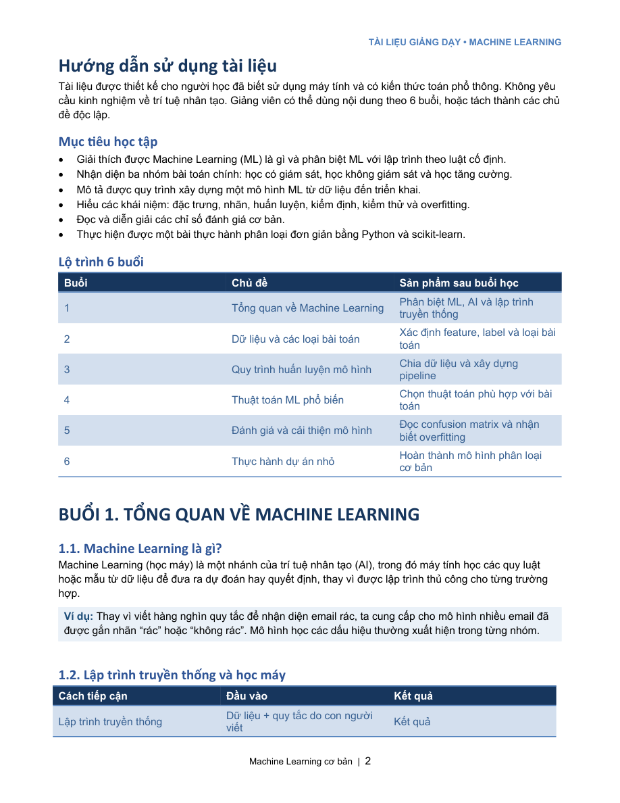 | 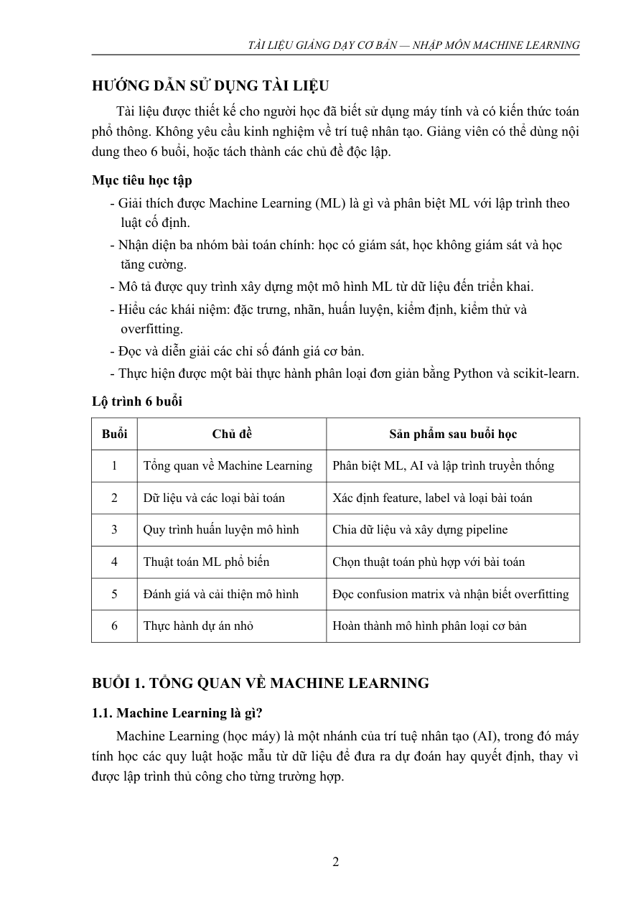 |
| **Trang 2 (Before):** Font Arial, chữ xanh in trên nền bảng tô xanh/zebra, bullet `•`, cột `Buổi` rộng `5.84 cm` bằng cột mô tả, bảng `1.2.` rớt dòng cuối sang trang 3 không lặp tiêu đề. | **Trang 2 (After):** A4 chuẩn, Times New Roman `#000000`, gạch đầu dòng `- ` thẳng hàng, `Table Grid` in trắng đen sắc nét, cột `Buổi` thu gọn `1.5 cm` nhường chỗ cho nội dung. |
| 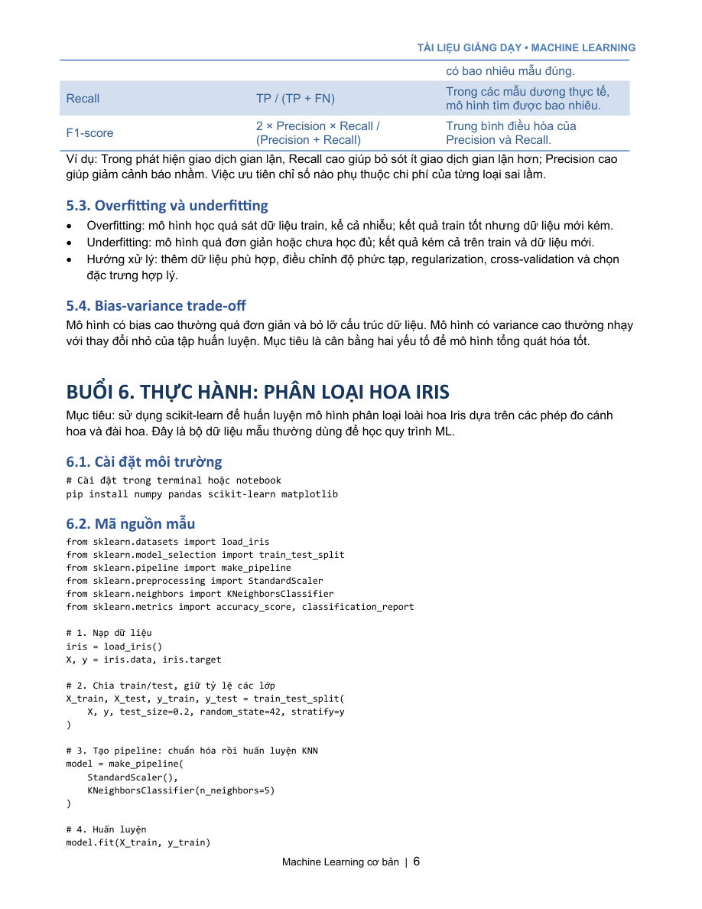 | 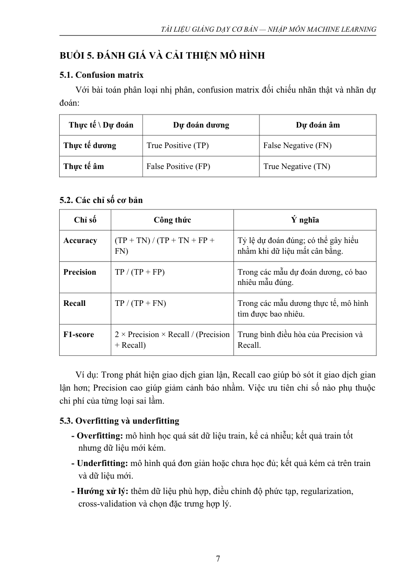 |
| **Bảng 5.2 (Before):** `tblHeader = False`, `cantSplit = 0` làm hàng **`Precision` bị xé đôi giữa câu qua trang 5–6** (*"có bao nhiêu mẫu đúng."* rớt lẻ không tiêu đề bảng); code mục `6.2.` đứt dòng qua trang 7. | **Bảng 5.2 (After):** Khóa `cantSplit` + lặp tiêu đề `tblHeader` giúp bảng `5.1.` và `5.2.` nguyên vẹn, dễ đối chiếu và không bao giờ xé đôi một hàng giữa trang. |
| 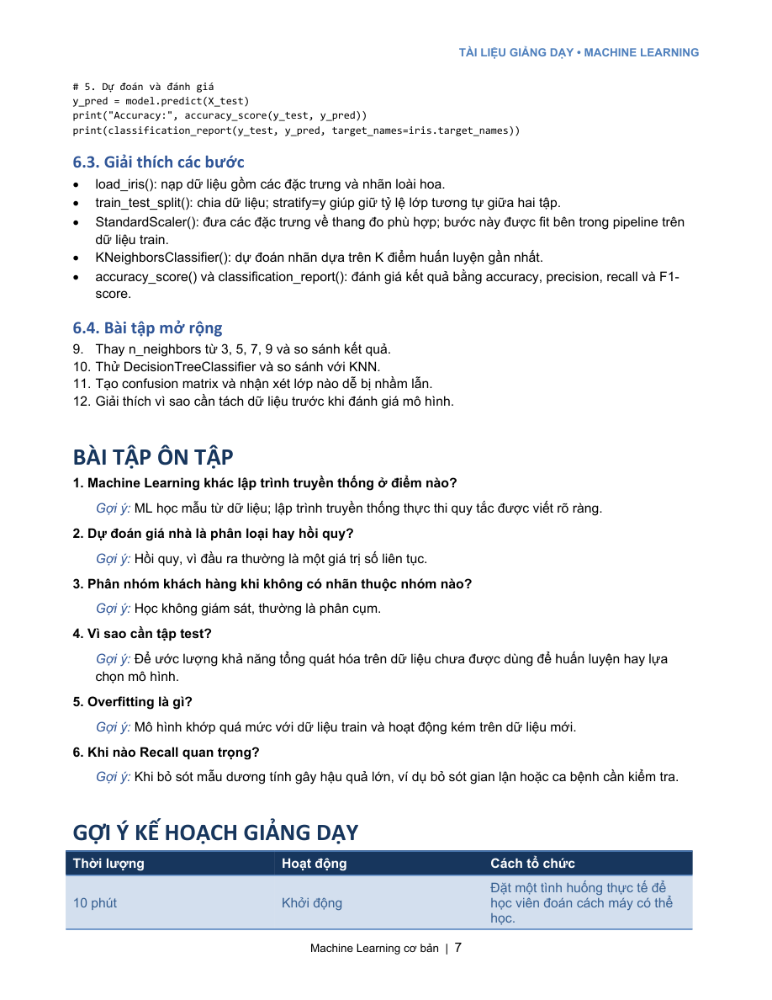 | 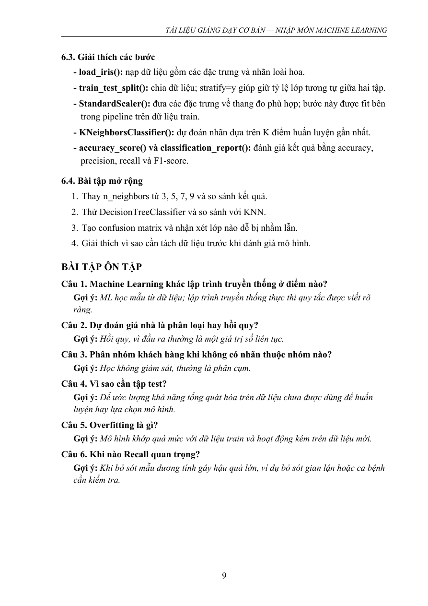 |
| **Mục 6.4 & Ôn tập (Before):** Tái sử dụng `List Number` không reset `abstractNum` khiến mục `6.4.` **nhảy số thành `9. 10. 11. 12.`**; phần Ôn tập đổi kiểu đánh số cứng, chữ `Gợi ý:` xanh nghiêng lệch tone, bảng cuối vỡ ngay sau hàng 1. | **Mục 6.4 & Ôn tập (After):** `add_numbered(start=1)` cấp `w:abstractNum` riêng nên mục `6.4.` đánh số chuẩn **`1. 2. 3. 4.`**; phần Ôn tập đồng bộ **`Câu 1.`–`Câu 6.`** + `Gợi ý:` màu đen `#000000` nhất quán. |

<details>
<summary>Xem thêm đối chiếu Trang bìa (Trang 1 Machine Learning) và đối chiếu Văn bản Hành chính NĐ 30/2020 (Before/After)</summary>

| Trang bìa AI mặc định (Before) | Trang bìa dùng `vietnamese-docs-style` (After) |
| :---: | :---: |
| 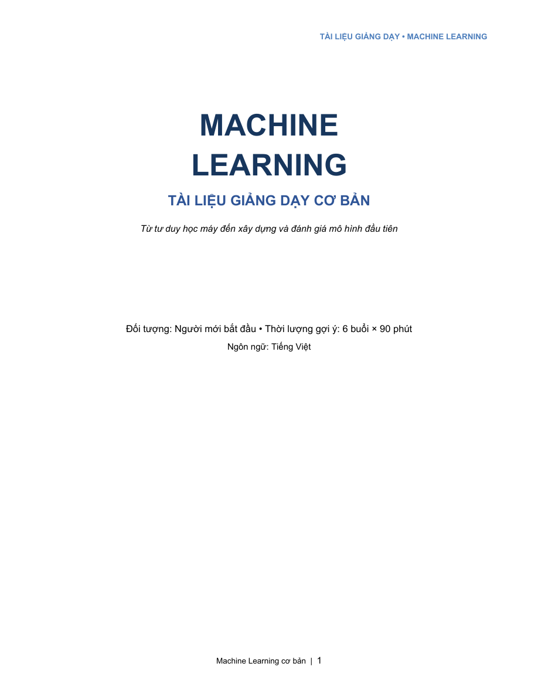 | 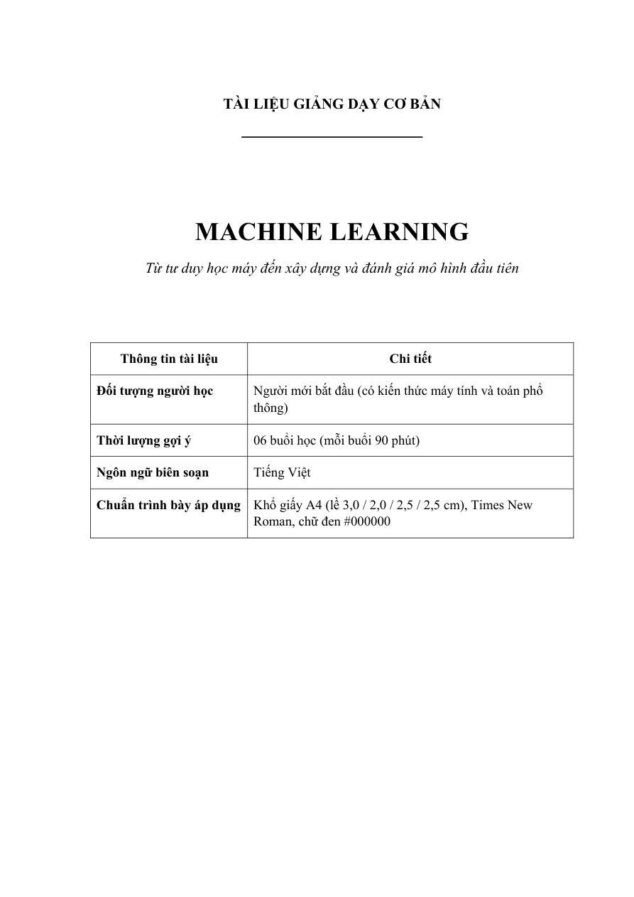 |
| Bìa dính header `TÀI LIỆU GIẢNG DẠY • MACHINE LEARNING`, số trang `1` ở đáy, chữ `MACHINE / LEARNING` gãy 2 dòng, màu xanh không đồng bộ. | Tắt header/số trang bìa (`different_first_page_header_footer = True`), `MACHINE LEARNING` trên một dòng, bảng tóm tắt chuẩn A4 rõ ràng. |

| File Word mặc định (`before-naive`) | Starter NĐ30 đã kiểm tra (`after-audit-notice`) |
| :---: | :---: |
|  |  |
| **`validate_docx.py` → `fail` (4 lỗi):** sai khổ giấy sang US Letter, lề mặc định Word, font Calibri theme, gạch ngang `---` và thiếu bố cục `Số:`/`Ngày`, `Nơi nhận:`. | **`validate_docx.py` → `pass` (0 lỗi):** đúng khổ A4, lề chuẩn NĐ30, Times New Roman `#000000`, `Số:`/`Ngày` thẳng hàng và khối `Nơi nhận:`/ký tách rõ ràng. |

Xem thêm đối chiếu với 2 văn bản `.docx` thật (**UBND xã Hương Khê, Hà Tĩnh 11/2026** và **Cục Quản lý đăng ký kinh doanh Mẫu 27, 2025**) tại [evals/audit-comparison.md](evals/audit-comparison.md).

</details>

### Văn bản hành chính NĐ 30/2020 tạo bằng skill

Ảnh dưới là kết quả render (`vndocs render --png` bằng LibreOffice và PyMuPDF) từ **Thông báo hành chính 2 trang ([`assets/examples/administrative-notice.docx`](assets/examples/administrative-notice.docx)) do skill tạo ra với dữ liệu giả định**:

| Trang 1 — Header NĐ30, căn cứ và bảng lặp tiêu đề | Trang 2 — Số trang `2` căn giữa, nơi nhận và khối ký |
| :---: | :---: |
| 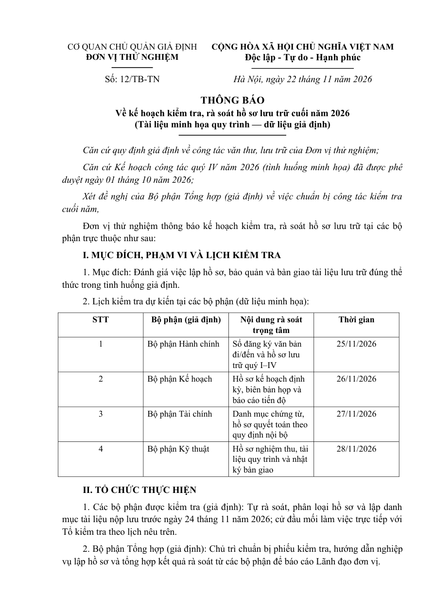 | 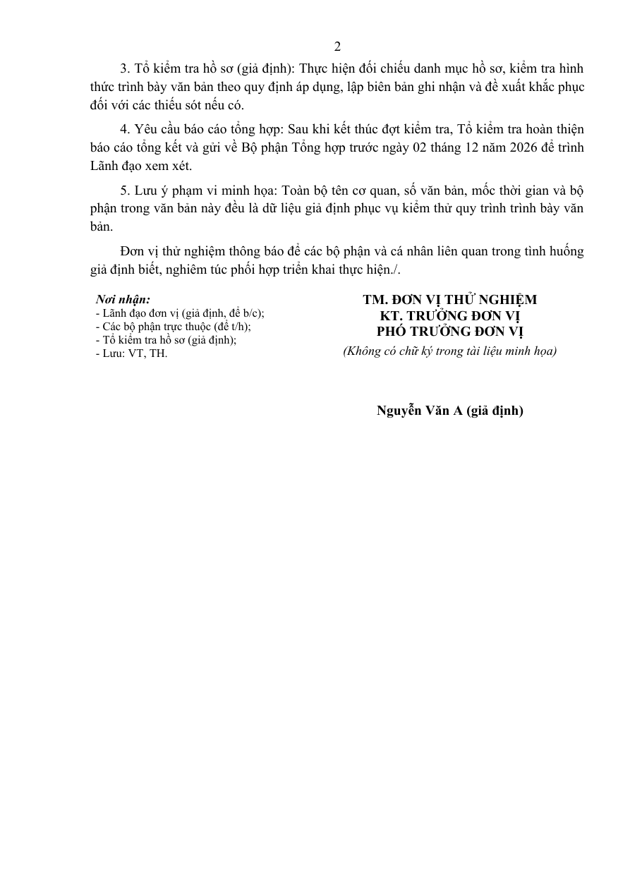 |

Tệp nguồn vượt qua `validate_docx.py --profile administrative` với 0 lỗi (không tạo chữ ký hay con dấu giả). Chi tiết thông số trình bày và kết quả đối chiếu với văn bản thật nằm ở [evals/audit-comparison.md](evals/audit-comparison.md).

### Bộ 10 tài liệu `.docx` mẫu bản đầy đủ nhiều trang ([Xem toàn bộ 32 trang ảnh tại `assets/examples/`](assets/examples/README.md))

Vì trình duyệt trên GitHub không hiển thị trực tiếp nội dung file `.docx`, bạn có thể **bấm vào cột "Xem ảnh trực tiếp" trong bảng dưới** (hoặc mở [`assets/examples/README.md`](assets/examples/README.md)) để xem ngay toàn bộ **32 trang ảnh kết xuất thực tế**, hoặc bấm **[Tải `.docx`]** để tải file Word về máy. Tất cả 10 tài liệu đều đạt `vndocs validate` (`status: pass`, `0` lỗi), bảng biểu chia cột cố định theo trọng số nội dung (`w:tblLayout="fixed"`) và khối chữ ký khóa chống rớt lẻ trang:

| # | Xem ảnh trực tiếp (32 trang PNG) | Quy chuẩn / Profile | Số trang | Nguồn tạo | Tải file Word |
| :-: | --- | --- | :-: | --- | :-: |
| 1 | [Xem ảnh Thông báo NĐ 30/2020 (Mẫu 1.4)](assets/examples/README.md#1-thông-báo-hành-chính-nđ-302020nđ-cp--mẫu-14-2-trang) | `administrative` | **2 trang** | Starter `administrative-notice` | [Tải `.docx`](assets/examples/administrative-notice.docx?raw=1) |
| 2 | [Xem ảnh Công văn NĐ 30/2020 (Mẫu 1.5)](assets/examples/README.md#2-công-văn-hành-chính-nđ-302020nđ-cp--mẫu-15-3-trang) | `administrative` | **3 trang** | Starter `administrative-dispatch` | [Tải `.docx`](assets/examples/administrative-dispatch.docx?raw=1) |
| 3 | [Xem ảnh Nghị quyết Chi bộ (QĐ 399 & HD 05)](assets/examples/README.md#3-nghị-quyết-chi-bộ-qđ-399-qđtw--hd-05-hdvptw-4-trang) | `party` | **4 trang** | Starter `party-resolution` | [Tải `.docx`](assets/examples/party-resolution.docx?raw=1) |
| 4 | [Xem ảnh Đề thi kết thúc học phần + Ma trận CLO](assets/examples/README.md#4-đề-thi-kết-thúc-học-phần-chính-thức--ma-trận-clo-3-trang) | `academic` | **3 trang** | Starter `exam-paper` | [Tải `.docx`](assets/examples/exam-paper.docx?raw=1) |
| 5 | [Xem ảnh Đề cương nghiên cứu luận văn thạc sĩ](assets/examples/README.md#5-đề-cương-nghiên-cứu-luận-văn-thạc-sĩ-4-trang) | `academic` | **4 trang** | Starter `thesis-research-outline` | [Tải `.docx`](assets/examples/thesis-research-outline.docx?raw=1) |
| 6 | [Xem ảnh Báo cáo kỹ thuật & thực nghiệm học thuật](assets/examples/README.md#6-báo-cáo-kỹ-thuật--kết-quả-thực-nghiệm-học-thuật-3-trang) | `academic` | **3 trang** | Starter `academic-short-report` | [Tải `.docx`](assets/examples/academic-short-report.docx?raw=1) |
| 7 | [Xem ảnh Biên bản họp A4 dọc + Phụ lục A4 ngang](assets/examples/README.md#7-biên-bản-họp-nội-bộ-a4-dọc--phụ-lục-bảng-theo-dõi-a4-ngang-3-trang) | `minutes-general` | **3 trang** | Starter `office-minutes` | [Tải `.docx`](assets/examples/office-minutes.docx?raw=1) |
| 8 | [Xem ảnh Công văn NĐ 30/2020 sinh từ JSON](assets/examples/README.md#8-công-văn-nđ-302020nđ-cp-sinh-tự-động-từ-json-3-trang) | `administrative` | **3 trang** | [`nd30-dispatch.json`](assets/schemas/examples/nd30-dispatch.json) | [Tải `.docx`](assets/examples/from-json-nd30-dispatch.docx?raw=1) |
| 9 | [Xem ảnh Nghị quyết Chi bộ HD 05 sinh từ JSON](assets/examples/README.md#9-nghị-quyết-chi-bộ-hd-05-hdvptw-sinh-tự-động-từ-json-3-trang) | `party` | **3 trang** | [`party-resolution.json`](assets/schemas/examples/party-resolution.json) | [Tải `.docx`](assets/examples/from-json-party-resolution.docx?raw=1) |
| 10 | [Xem ảnh Báo cáo chuyên đề học thuật sinh từ JSON](assets/examples/README.md#10-báo-cáo-chuyên-đề-học-thuật-sinh-tự-động-từ-json-4-trang) | `academic` | **4 trang** | [`academic-report.json`](assets/schemas/examples/academic-report.json) | [Tải `.docx`](assets/examples/from-json-academic-report.docx?raw=1) |

#### Ảnh xem trực tiếp các mẫu tiêu biểu (Bấm vào ảnh để phóng to)

**Công văn Hành chính NĐ 30/2020 — Mẫu 1.5 (3 trang · [Xem đủ / Tải `.docx`](assets/examples/README.md#2-công-văn-hành-chính-nđ-302020nđ-cp--mẫu-15-3-trang)):**

| Trang 1 — Quốc hiệu, Số/Trích yếu `V/v`, Kính gửi | Trang 2 — Bảng phân bổ chỉ tiêu 6 đơn vị | Trang 3 — Đoạn kết gắn liền Nơi nhận & KT. Giám đốc |
| :---: | :---: | :---: |
| 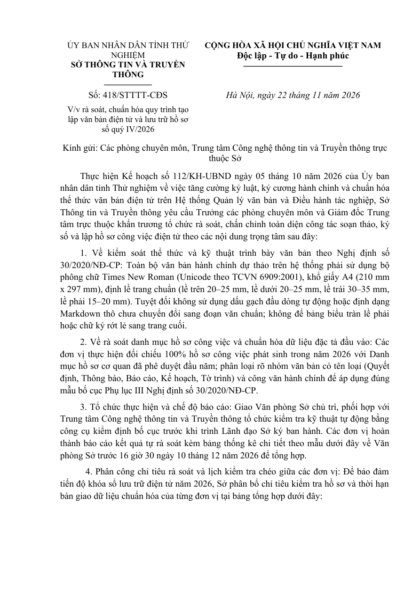 | 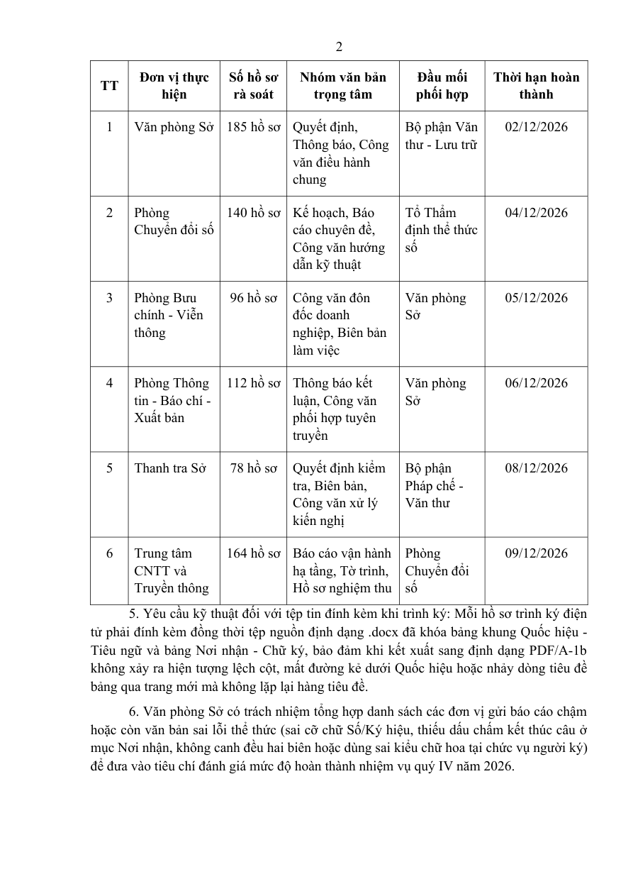 |  |

**Báo cáo Chuyên đề Học thuật Sinh từ JSON (4 trang · [Xem đủ / Tải `.docx`](assets/examples/README.md#10-báo-cáo-chuyên-đề-học-thuật-sinh-tự-động-từ-json-4-trang)):**

| Trang 1 — Đặt vấn đề & Mục 2.1 | Trang 2 — Bảng so sánh 5 Profile & Mục 2.2 | Trang 3 — Mục 3 & Bảng kết quả thực nghiệm | Trang 4 — Bảng thực nghiệm (tiếp) & Kết luận |
| :---: | :---: | :---: | :---: |
| 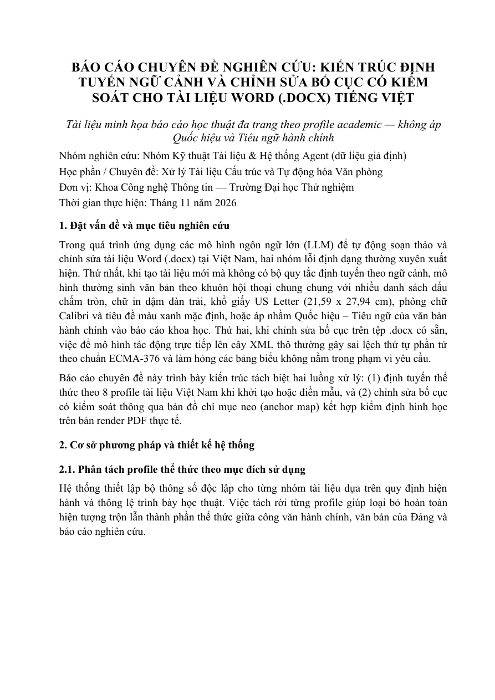 |  | 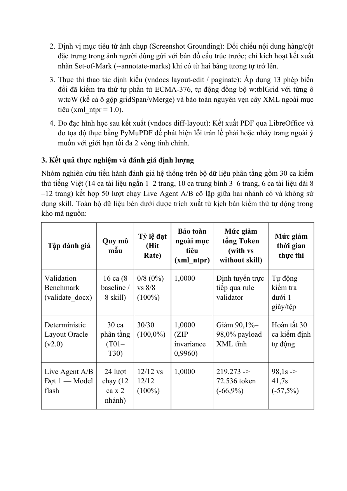 | 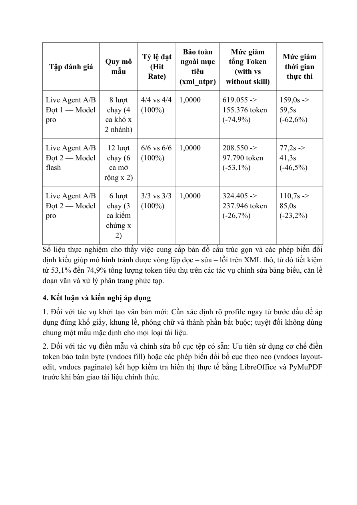 |

**Đề thi Kết thúc Học phần Chính thức + Ma trận CLO (3 trang · [Xem đủ / Tải `.docx`](assets/examples/README.md#4-đề-thi-kết-thúc-học-phần-chính-thức--ma-trận-clo-3-trang)):**

| Trang 1 — Khung Trường/Khoa, Mã đề 204 & Câu 1–3 | Trang 2 — Bảng dữ liệu Câu 3, Câu 4–5 & Ma trận CLO | Trang 3 — Ma trận CLO (tiếp), `--- HẾT ---` & Chữ ký duyệt |
| :---: | :---: | :---: |
| 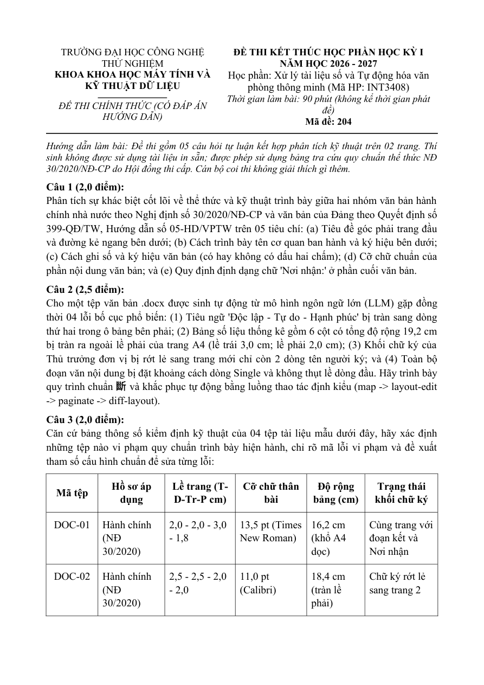 | 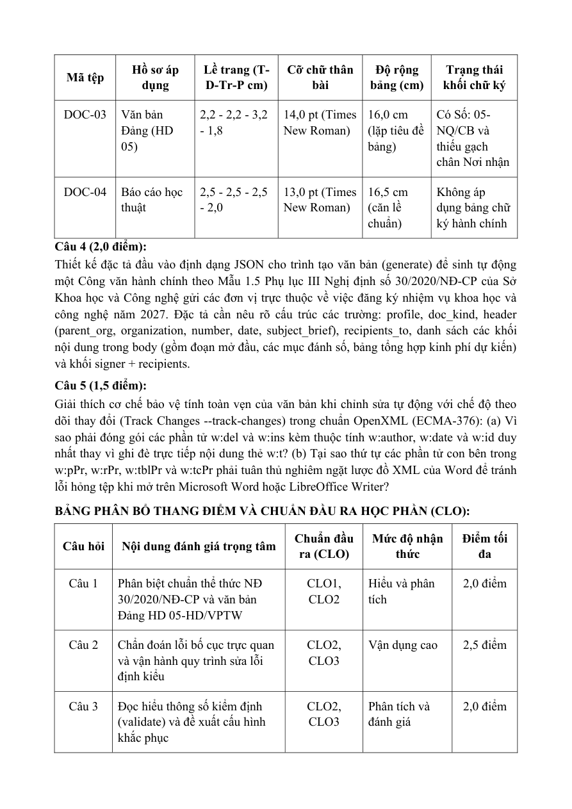 |  |

**Biên bản Họp Nội bộ Khổ A4 Dọc + Phụ lục Bảng Theo dõi Khổ A4 Ngang (3 trang · [Xem đủ / Tải `.docx`](assets/examples/README.md#7-biên-bản-họp-nội-bộ-a4-dọc--phụ-lục-bảng-theo-dõi-a4-ngang-3-trang)):**

| Trang 1 (A4 Dọc) — Nội dung thảo luận & Quyết định | Trang 2 (A4 Dọc) — Bảng phân công 5 nhiệm vụ | Trang 3 (A4 Ngang) — Phụ lục bảng theo dõi 7 cột |
| :---: | :---: | :---: |
|  |  |  |

<details>
<summary>Xem thêm ảnh các mẫu còn lại: Đề cương luận văn (4 trang), Báo cáo ngắn (3 trang), Công văn JSON (3 trang), Nghị quyết Chi bộ (4 trang), Nghị quyết JSON (3 trang)</summary>

**5. Đề cương nghiên cứu luận văn ([Xem trong gallery](assets/examples/README.md#5-đề-cương-nghiên-cứu-luận-văn-thạc-sĩ-4-trang) — 4 trang):**

| Trang 1 — Thông tin học viên & Mục 1 | Trang 2 — Câu hỏi nghiên cứu, Mục 2 & Mục 3 | Trang 3 — Bảng cấu trúc 4 chương & Mục 4 Tiến độ | Trang 4 — Bảng tiến độ (tiếp) & 6 Tài liệu tham khảo |
| :---: | :---: | :---: | :---: |
| 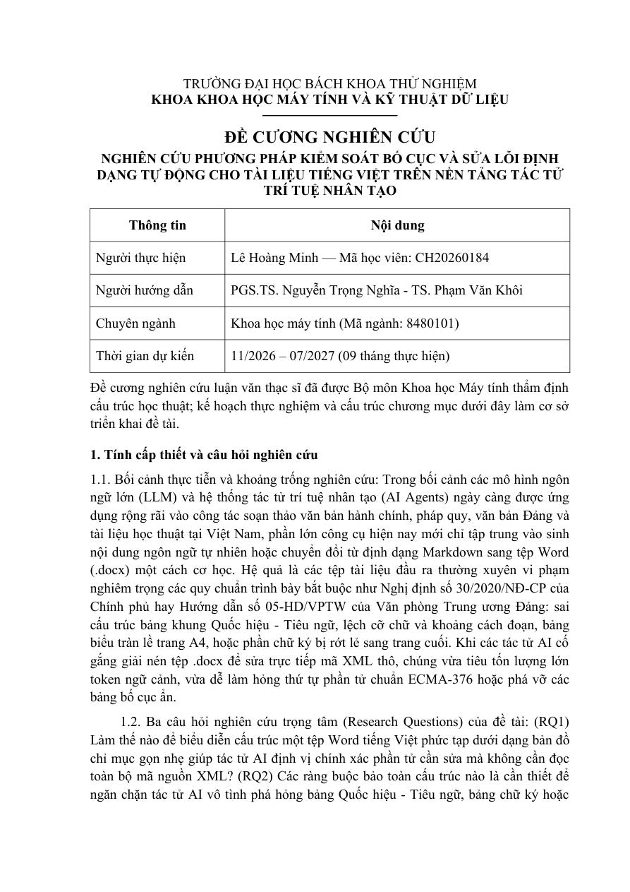 | 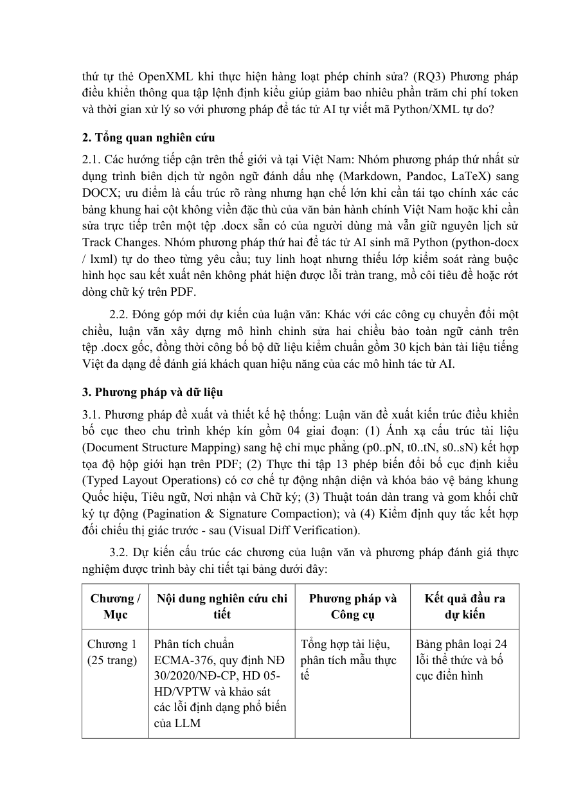 | 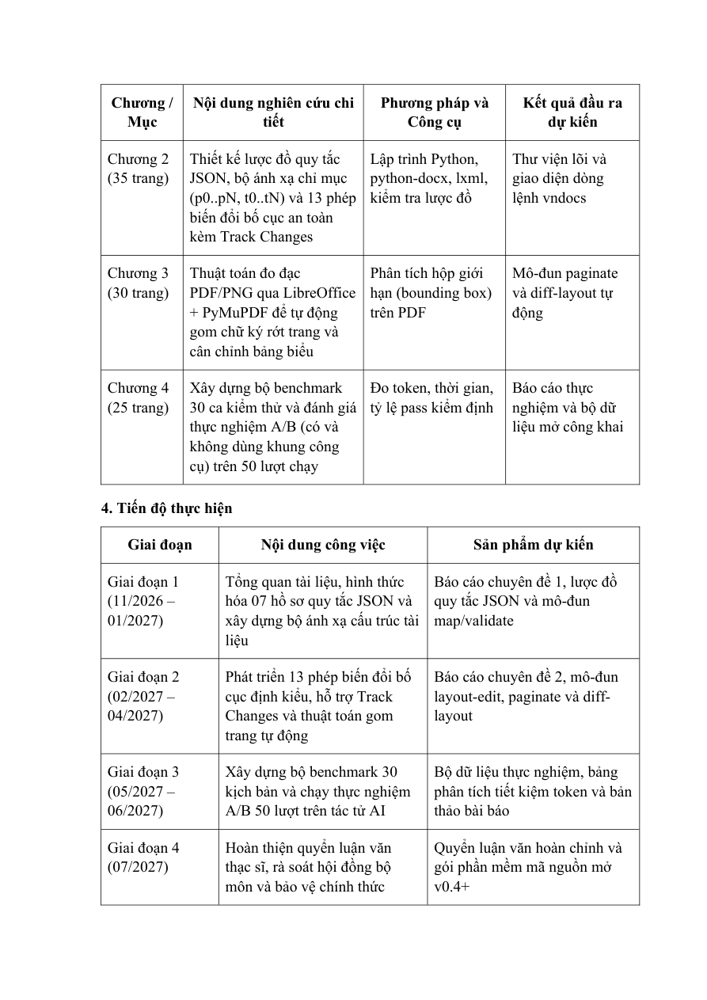 | 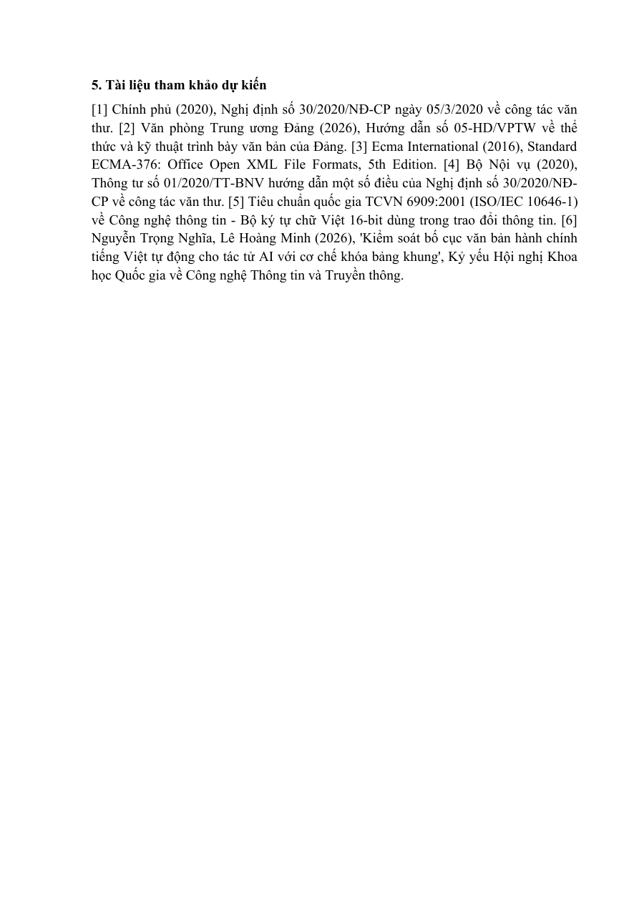 |

**6. Báo cáo kỹ thuật học thuật ([Xem trong gallery](assets/examples/README.md#6-báo-cáo-kỹ-thuật--kết-quả-thực-nghiệm-học-thuật-3-trang) — 3 trang):**

| Trang 1 — Mục đích & Phương pháp | Trang 2 — Kết quả & Bảng tổng hợp A/B 50 lượt | Trang 3 — Hạn chế, Tài liệu tham khảo & Bảng kiểm tra |
| :---: | :---: | :---: |
| 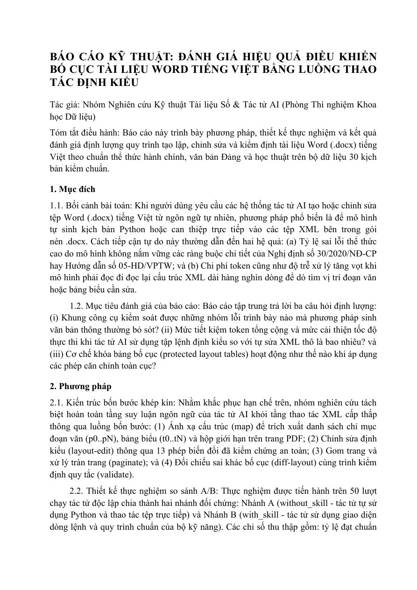 |  | 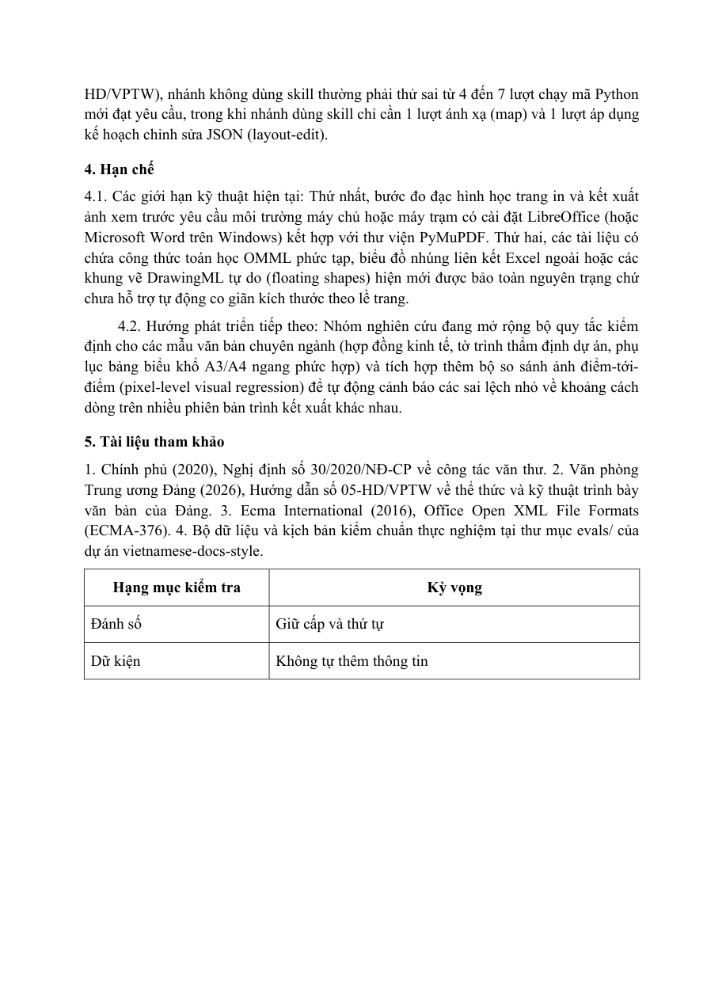 |

**8. Công văn NĐ30 sinh từ JSON ([Xem trong gallery](assets/examples/README.md#8-công-văn-nđ-302020nđ-cp-sinh-tự-động-từ-json-3-trang) — 3 trang):**

| Trang 1 — Mở đầu & Mục I, II | Trang 2 — Bảng danh mục 7 nhóm hồ sơ nộp lưu | Trang 3 — Mục III & Khối Nơi nhận / Ký |
| :---: | :---: | :---: |
| 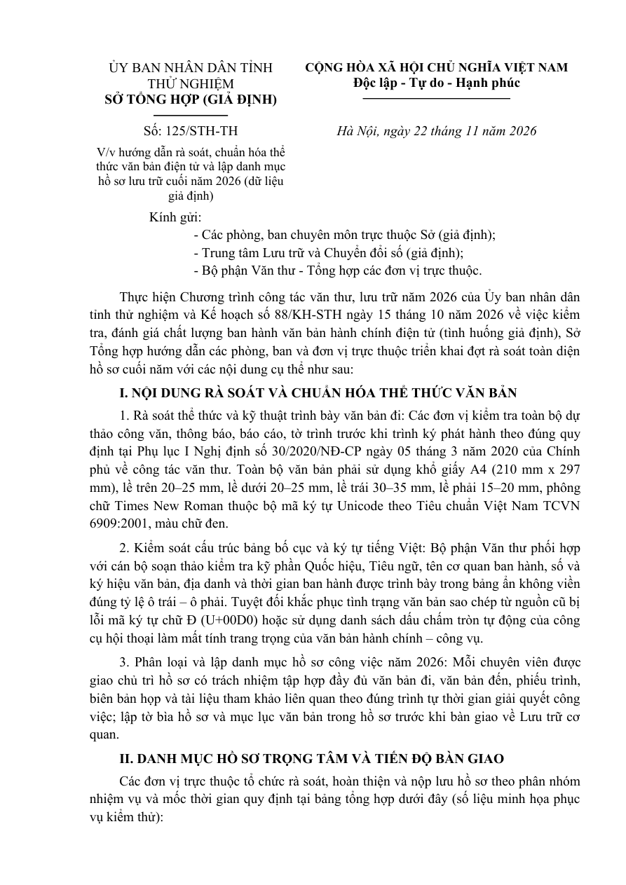 | 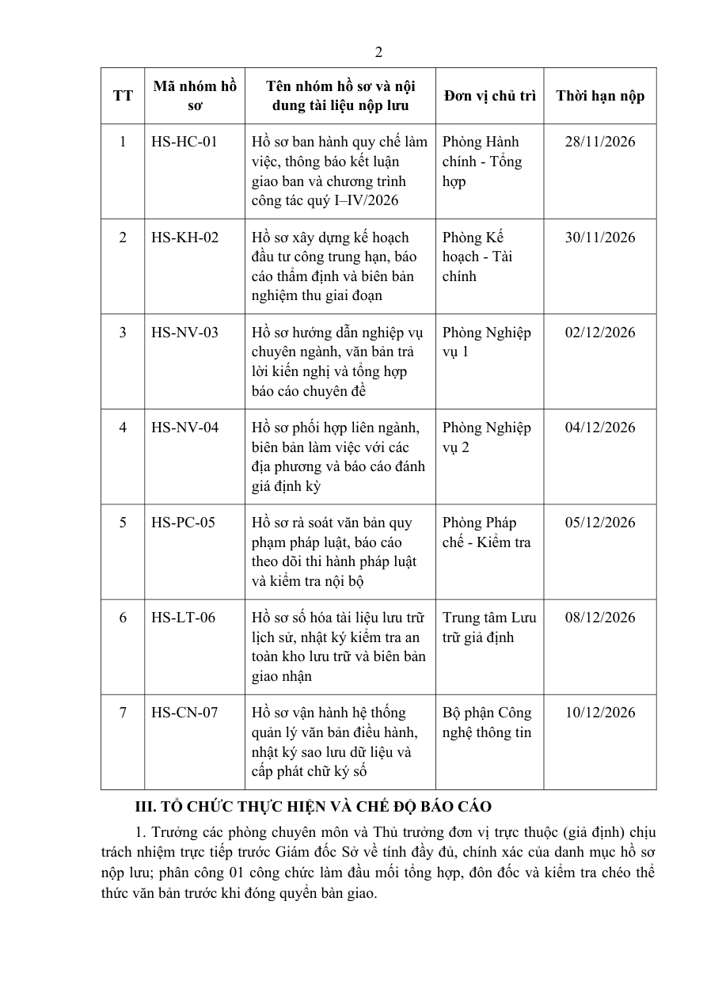 | 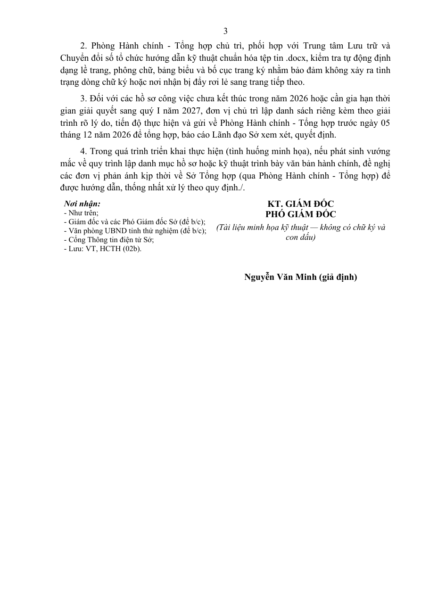 |

**Nghị quyết Chi bộ QĐ 399-QĐ/TW & HD 05-HD/VPTW (4 trang · [Xem đủ / Tải `.docx`](assets/examples/README.md#3-nghị-quyết-chi-bộ-qđ-399-qđtw--hd-05-hdvptw-4-trang)):**

| Trang 1 — Header Đảng, `Số 06-NQ/CB`, Căn cứ & Phần I | Trang 2 — Phần II & Bảng phân công chuyên đề | Trang 3 — Bảng chuyên đề (tiếp) & Phần III | Trang 4 — Đoạn kết, `Nơi nhận:` gạch chân & `T/M CHI BỘ` |
| :---: | :---: | :---: | :---: |
| 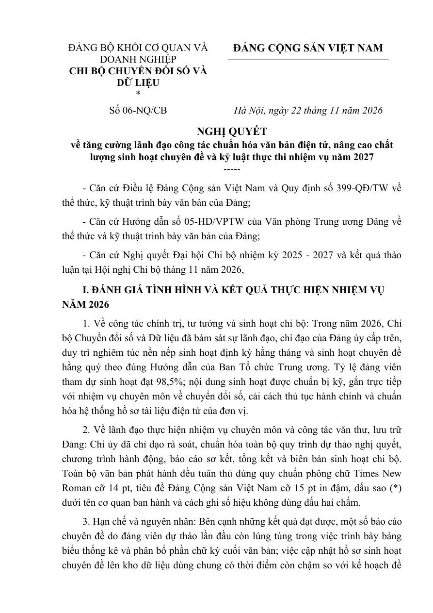 | 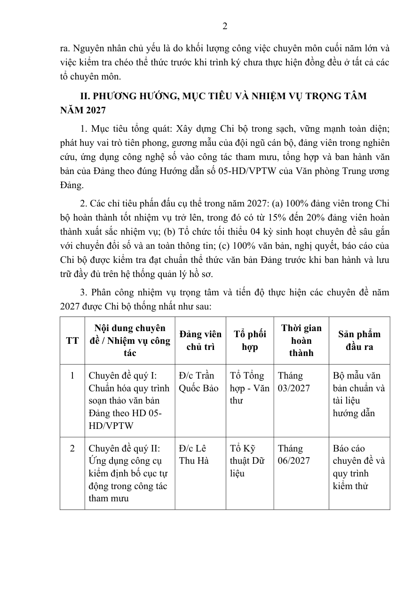 |  |  |

**9. Nghị quyết Chi bộ sinh từ JSON ([Xem trong gallery](assets/examples/README.md#9-nghị-quyết-chi-bộ-hd-05-hdvptw-sinh-tự-động-từ-json-3-trang) — 3 trang):**

| Trang 1 — Căn cứ, Phần I & Phần II | Trang 2 — Bảng phân công nhiệm vụ năm 2027 | Trang 3 — Phần III, Nơi nhận gạch chân & Chữ ký |
| :---: | :---: | :---: |
| 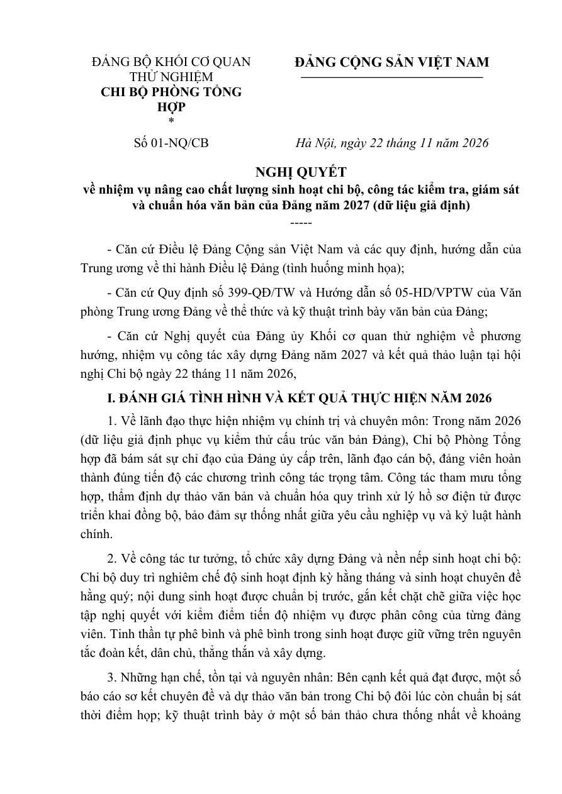 |  |  |

</details>

## Giới thiệu ngắn

Khi tạo `.docx` không có ràng buộc ngữ cảnh, phần lớn AI đi theo thói quen "xuất Markdown sang Word" mang tính thẩm mỹ màn hình phương Tây: khổ US Letter (`21.59 × 27.94 cm`), font Arial/Calibri, tiêu đề và bảng tô màu xanh đậm/zebra khó đọc khi in trắng đen, danh sách dấu chấm tròn (`•`), **in đậm** và *in nghiêng* thiếu nhất quán, đánh số list dùng chung `abstractNum` khiến phần sau bị nhảy nối số (`9. 10. 11. 12.`), còn bảng biểu chia cột cào bằng không có `tblHeader` / `cantSplit` khiến một hàng bị xé đôi ngay giữa trang.

Ngược lại, văn bản tiếng Việt trong công việc thực tế **chịu sự chi phối của nhiều quy chuẩn trình bày nghiêm ngặt do Chính phủ và cơ quan Trung ương ban hành**: **Nghị định 30/2020/NĐ-CP** (văn bản hành chính nhà nước: bảng Quốc hiệu – Tiêu ngữ 2×2, cỡ chữ 13–14pt, lề bất đối xứng đóng quyển, khối Nơi nhận/Chữ ký), **Quy định 399-QĐ/TW & Hướng dẫn 05-HD/VPTW** (văn bản Đảng: `Số` không dấu hai chấm, 14pt, giãn dòng cố định 20pt, `Nơi nhận:` gạch chân, chức vụ không đậm), **Nghị định 187/2025/NĐ-CP** (VBQPPL), cùng chuẩn in A4 đen trắng tách biệt cho học thuật, giáo trình, đề thi và biên bản doanh nghiệp.

`vietnamese-docs-style` giải quyết bài toán trên bằng hai lớp phối hợp: bộ hướng dẫn định tuyến theo ngữ cảnh ([SKILL.md](SKILL.md), [AGENTS.md](AGENTS.md), `references/`) giúp AI chọn đúng thể thức ngay từ đầu, kết hợp cùng CLI `vndocs` để khởi tạo sạch, điền mẫu bảo toàn byte, chỉnh sửa bố cục có kiểm soát (`map -> layout-edit / paginate -> diff-layout`) và kiểm chứng trực tiếp bằng LibreOffice + PyMuPDF.

## Tính năng chính

- Chọn thể thức phù hợp với loại văn bản và nơi tiếp nhận thông qua 8 profile, hỗ trợ văn bản hành chính theo NĐ30/2020, văn bản của Đảng (QĐ 399-QĐ/TW, HD 05-HD/VPTW), VBQPPL (NĐ 187/2025/NĐ-CP), tài liệu học thuật và tài liệu doanh nghiệp.
- Sinh file `.docx` đa profile từ JSON đúng [JSON Schema](assets/schemas/document-input.schema.json) (`vndocs generate ... --validate`), điền token `{{name}}` (`vndocs fill`) hoặc vá vị trí xác minh bằng `vndocs edit --source-sha256`, giữ nguyên XML ngoài vùng sửa.
- Chỉnh sửa bố cục `.docx` hiện có theo quy trình 4 bước (`vndocs map` -> đối chiếu ảnh/`--annotate-marks` -> `vndocs layout-edit` với 13 op có `--track-changes` và bảo toàn namespace Word 365 -> `vndocs diff-layout` đo PDF trước/sau), kèm `vndocs paginate` tự co gọn bố cục đúng chuẩn profile (gom chữ ký rơi lẻ sang trang cuối hoặc ép vừa số trang) mà không sửa bất kỳ từ nào (`xml_ntpr == 1.0`).
- Soi nhanh file mẫu và phát hiện lỗi encoding `Ð` (`U+00D0` -> `Đ` `U+0110`), `kính giửi` hoặc placeholder sót qua `vndocs inspect`; kiểm tra khổ giấy, lề, font/màu kế thừa, style role và numbering qua `vndocs validate`.
- Render PDF và PNG từng trang bằng LibreOffice + PyMuPDF trong profile tạm (`vndocs render --png`, hỗ trợ cache PDF theo `SHA-256` qua `--cache-dir` và tùy chọn `--renderer word-win` trên máy Windows có Microsoft Word) để kiểm tra hiển thị thực tế trước khi bàn giao.
- Kèm bộ câu hỏi phỏng vấn ([interview-questions.md](references/interview-questions.md)), hướng dẫn xem trước Markdown ([markdown-preview-fallback.md](references/markdown-preview-fallback.md)), chỉ mục [llms.txt](llms.txt) và đóng gói thành file ZIP (`vndocs package`).

### Các profile được hỗ trợ

| Profile | Nhóm tài liệu | Rule & Validator | Starter template / Cấu hình tham chiếu |
| --- | --- | --- | --- |
| `academic` | Báo cáo học thuật, tiểu luận, nghiên cứu, đề cương, đề thi | Đầy đủ | [`academic-short-report`](assets/templates/academic-short-report.docx), [`exam-paper`](assets/templates/exam-paper.docx), [`thesis-research-outline`](assets/templates/thesis-research-outline.docx) |
| `office` | Thông báo, ghi nhớ, báo cáo nội bộ văn phòng | Builder & validator | Dựng qua `build_docx` hoặc mẫu tổ chức |
| `minutes-general` | Biên bản họp nhóm, họp nội bộ doanh nghiệp | Đầy đủ | [`office-minutes`](assets/templates/office-minutes.docx) |
| `proposal` | Đề xuất dự án, kế hoạch công việc | Builder & validator | Dựng qua `build_docx` hoặc mẫu tổ chức |
| `administrative` | Thông báo, công văn, quyết định, tờ trình thuộc NĐ30/2020 ([29 loại & ký hiệu](references/administrative-doc-types-nd30.md), [văn phong](references/administrative-writing-style.md)) | Đầy đủ | [`administrative-notice`](assets/templates/administrative-notice.docx), [`administrative-dispatch`](assets/templates/administrative-dispatch.docx) (Mẫu 1.4, 1.5 NĐ30); VBQPPL dùng kèm [`legal-normative.json`](assets/rules/legal-normative.json) ([tham chiếu](references/legal-normative-documents.md)) |
| `party` | Văn bản của Đảng theo QĐ 399-QĐ/TW & HD 05-HD/VPTW ([tham chiếu](references/party-documents.md)) | Builder & validator | [`party-resolution`](assets/templates/party-resolution.docx) |
| `minutes-administrative` | Biên bản thủ tục hành chính cụ thể | Rule lề/font/số trang | Chọn mẫu đúng thủ tục thực tế |
| `custom` | Biểu mẫu `.docx` riêng của trường/cơ quan/công ty | Giữ mẫu; kiểm theo `--config` | Người dùng cung cấp ([ví dụ config](assets/rules/custom-example.json)) |

### Benchmark: Baseline 0/8 vs. Skill 8/8

Benchmark gồm **16 test case**, chạy bằng `python evals/run_validation_benchmark.py` (8 file baseline mặc định vs. 8 đầu ra dùng skill). Kết quả đo hành vi của bộ công cụ `validate_docx.py`, không phải đánh giá chất lượng sinh văn bản của từng mô hình LLM:

| Hạng mục kiểm tra (`validate_docx.py`) | Baseline mặc định | Đầu ra dùng Skill |
| --- | :---: | :---: |
| **Tổng số case đạt `pass`** | **0 / 8 (0%)** | **8 / 8 (100%)** |
| Khổ giấy & lề hành chính NĐ30 (`administrative`, `minutes-administrative`) | 0 / 3 pass (`margin`, `page`) | 0 lỗi |
| Văn bản của Đảng (`party` — HD 05-HD/VPTW vs. áp nhầm lề NĐ30) | 0 / 1 pass (`margin`) | 1 / 1 pass |
| VBQPPL (`administrative` + `legal-normative.json` — NĐ 187/2025) | 0 / 1 pass (`margin`) | 1 / 1 pass |
| Font & màu chữ (`font`, `color`) | 2/2 case gán sai bị bắt | 0 lỗi |
| Placeholder sót / `numId` hỏng (`placeholder`, `numbering`) | 3/3 case lỗi bị bắt | 0 lỗi |

Xem bảng đầy đủ, file JSON cho CI và đối chiếu văn bản thật tại: [`evals/BENCHMARK.md`](evals/BENCHMARK.md) · [`evals/benchmark-results.json`](evals/benchmark-results.json) · [`evals/audit-comparison.md`](evals/audit-comparison.md) · [`evals/manual-results.md`](evals/manual-results.md).

### Benchmark chỉnh sửa bố cục: 30/30 Oracle Hit, `xml_ntpr = 1.0` & So sánh Live Agent A/B

Bộ dataset phân tầng **30 ca (`T01`–`T30`)** trên tài liệu ngắn/trung bình/dài (`short: 14`, `medium: 10`, `long: 6`, mô tả tại [`evals/layout_edit_cases.json`](evals/layout_edit_cases.json), tái tạo `.docx` bằng `python evals/run_layout_benchmark.py --generate-corpus`). Đây là benchmark nội bộ do dự án thiết kế cho ngữ cảnh tiếng Việt (`T01`–`T18` đã chạy **50 lượt Live Agent A/B cô lập** với `0` ca nhiễu Arm A; `T19`–`T30` kiểm chứng bằng oracle xác định):

| Nhóm kiểm thử (`with_skill` vs `without_skill`) | Model | Hit Rate | Mean Total Tok (`without -> with`) | Mean Calls | Mean Time (s) |
| --- | --- | :---: | :---: | :---: | :---: |
| Live A/B Đợt 1 (`T01`–`T12`: bảng, grid/vMerge, xoay ngang, từ chối) | `flash` (12 ca × 2) | 12/12 vs 12/12 | `219,273 -> 72,536` (**-66.9%**) | `11.3 -> 6.3` | `98.1 -> 41.7` (**-57.5%**) |
| Live A/B Đợt 1 (`T03, T04, T07, T08`) | `pro` (4 ca × 2) | 4/4 vs 4/4 | `619,055 -> 155,376` (**-74.9%**) | `19.0 -> 9.5` | `159.0 -> 59.5` (**-62.6%**) |
| Live A/B Đợt 2 (`T13`–`T18`: ảnh crop, lề/font ô, ảnh, Đảng HD05, multi-op) | `flash` (6 ca × 2) | 6/6 vs 6/6 | `208,550 -> 97,790` (**-53.1%**) | `11.8 -> 7.0` | `77.2 -> 41.3` (**-46.5%**) |
| Live A/B Đợt 2 (`T13, T16, T17`) | `pro` (3 ca × 2) | 3/3 vs 3/3 | `324,405 -> 237,946` (**-26.7%**) | `17.7 -> 13.3` | `110.7 -> 85.0` (**-23.2%**) |

- **Oracle xác định 30 ca (`--run-oracle`):** **30 / 30 (100.0%)** đạt mọi checkpoint hình học PDF + OOXML, **100%** bảo toàn cấu trúc XML ngoài vùng sửa (`xml_ntpr = 1.0`), **4 / 4** ca rủi ro/mơ hồ từ chối an toàn (gồm `.docx` đã ký số `T28` và ảnh crop không phân biệt được `T17`).
- **Giảm payload ngữ cảnh (`vndocs map` vs `word/document.xml` thô):** giảm trung bình **90.1%** (`short`), **96.9%** (`medium`) và **98.0%** (`long`).
- **Dữ liệu & báo cáo đầy đủ (50 lượt A/B + 30 ca oracle + nguồn tham khảo):** [`evals/LAYOUT-BENCHMARK.md`](evals/LAYOUT-BENCHMARK.md) · [`evals/layout-benchmark-results.json`](evals/layout-benchmark-results.json) · [`evals/layout_edit_cases.json`](evals/layout_edit_cases.json).

## Cách bắt đầu

**Yêu cầu hệ thống:** Node.js/npm (nếu cài skill bằng `npx skills`) và Python `3.10+` (`python-docx`, `PyMuPDF`, `lxml` cài tự động cho bộ công cụ `vndocs`). LibreOffice chỉ cần khi xuất PDF/PNG bằng `vndocs render`.

### Dùng ngay trên Claude.ai / ChatGPT / Gemini (không cần cài CLI)

- Tải [`vietnamese-docx.zip`](https://github.com/bGiaHuy/vietnamese-docs-style/releases/latest) để nạp skill lên Claude hoặc tải lên khung chat có hỗ trợ chạy Python.
- Hoặc dán link `https://raw.githubusercontent.com/bGiaHuy/vietnamese-docs-style/main/llms.txt` vào prompt để AI tự đọc quy chuẩn và mẫu tương ứng.

### Cài và cập nhật skill qua `npx skills`

```bash
# Cài skill
npx skills add bGiaHuy/vietnamese-docs-style

# Kiểm tra bản cập nhật
npx skills check

# Cập nhật các skill đã cài
npx skills update
```

### Cài bộ công cụ Python `vndocs` từ source code

```bash
git clone https://github.com/bGiaHuy/vietnamese-docs-style.git
cd vietnamese-docs-style
python -m pip install -e .
# Nếu chỉ chạy trực tiếp `python scripts/...py` và không dùng `vndocs`:
# python -m pip install -r requirements.txt
# python scripts/cli.py doctor   # tương đương vndocs khi chạy từ vietnamese-docx.zip
vndocs doctor
```

### Tương thích AI Agent

| AI Agent / IDE | Tệp cấu hình trong repo | Cách tích hợp |
| --- | --- | --- |
| **Claude Code** | [SKILL.md](SKILL.md) | Đọc `SKILL.md` trong repo hoặc cài từ ZIP đóng gói qua `vndocs package --output dist/vietnamese-docx.zip` (giải nén vào `~/.claude/skills/vietnamese-docx/` hoặc `.claude/skills/vietnamese-docx/`) |
| **OpenAI Codex** | [AGENTS.md](AGENTS.md), [SKILL.md](SKILL.md) | Tự đọc `AGENTS.md` ở thư mục gốc và nạp `SKILL.md` theo nhu cầu |
| **Cursor** | [AGENTS.md](AGENTS.md), [SKILL.md](SKILL.md) | Mở repo làm workspace để nhận `AGENTS.md`, hoặc gắn `SKILL.md` vào rule/context |
| **Gemini CLI** | [SKILL.md](SKILL.md), [AGENTS.md](AGENTS.md) | Cài qua `npx skills add bGiaHuy/vietnamese-docs-style` hoặc đọc `SKILL.md` / `references/` |
| **Antigravity** | [SKILL.md](SKILL.md), [AGENTS.md](AGENTS.md) | Cài qua `npx skills` hoặc nhận diện tự động `SKILL.md` / `AGENTS.md` tại thư mục gốc (hoặc giải nén ZIP vào `~/.gemini/config/skills/vietnamese-docx/` / `.agents/skills/vietnamese-docx/`) |
| **GitHub Copilot (VS Code)** | [AGENTS.md](AGENTS.md), [SKILL.md](SKILL.md) | Đọc hướng dẫn repo qua `AGENTS.md` / `SKILL.md` trong workspace |
| **Windsurf** | [AGENTS.md](AGENTS.md), [SKILL.md](SKILL.md) | Mở workspace chứa `AGENTS.md` và trỏ agent tới `SKILL.md` |
| **OpenCode / Cline / Roo Code** | [AGENTS.md](AGENTS.md), [SKILL.md](SKILL.md) | Đọc chuẩn `AGENTS.md` ở gốc repo và gọi lệnh `vndocs` |

## Cách sử dụng

### Chạy thử bộ demo

```bash
vndocs demo --output-dir artifacts/demo
vndocs validate artifacts/demo/office-filled.docx --profile minutes-general
vndocs render artifacts/demo/office-filled.docx --png
```

### Thao tác thường dùng với CLI và Agent

- **Sinh DOCX từ JSON đa profile + tự kiểm tra ngay:**
  ```bash
  vndocs generate assets/schemas/examples/academic-report.json artifacts/bao-cao-hoc-thuat.docx --validate
  vndocs generate assets/schemas/examples/nd30-dispatch.json artifacts/cong-van.docx --validate
  vndocs generate assets/schemas/examples/party-resolution.json artifacts/nq-chibo.docx --validate
  ```
- **Soi mẫu cơ quan và chuẩn hóa ký tự `Ð` (`U+00D0` -> `Đ`) giữ nguyên XML khác:**
  ```bash
  vndocs inspect source.docx --normalize-output artifacts/clean-template.docx
  ```
- **Điền starter có sẵn (`{{token}}`):**
  ```bash
  vndocs fill assets/templates/administrative-notice.docx artifacts/notice.docx --values assets/templates/administrative-notice.values.json
  vndocs validate artifacts/notice.docx --profile administrative --config assets/templates/administrative-notice.rules.json
  ```
- **Sửa giữ nguyên mẫu có sẵn không dùng token:**
  ```bash
  vndocs edit source.docx artifacts/edited.docx --edits slots.json --source-sha256 <SHA256>
  ```
- **Chỉnh bố cục bảng/ảnh/đoạn/trang và đo lại bằng PDF (`map` -> `layout-edit` / `paginate` -> `diff-layout`):**
  ```bash
  vndocs map source.docx --format markdown
  vndocs layout-edit source.docx artifacts/scaled.docx --plan plan.json --track-changes
  vndocs diff-layout source.docx artifacts/scaled.docx --target <ANCHOR> --cache-dir .vndocs-cache
  vndocs paginate source.docx artifacts/onepage.docx --fix-orphan-signature --profile administrative
  ```
- **Prompt mẫu gửi AI Agent:**
  - *Hành chính:* `Tạo file DOCX thông báo lịch họp theo thể thức NĐ30/2020; chỗ nào thiếu thông tin ký hoặc số văn bản thì đánh dấu [CẦN BỔ SUNG: ...].`
  - *Học thuật:* `Viết báo cáo học thuật ngắn về ứng dụng AI trong giáo dục (chưa có mẫu trường), không tự thêm số liệu nghiên cứu.`
  - *Biên bản họp:* `Chuyển ghi chú họp sau thành biên bản họp nội bộ gồm thảo luận, quyết định đã chốt và bảng phân công.`
  - *Mẫu riêng:* `Điền dữ liệu vào mẫu DOCX đính kèm và giữ nguyên style, bảng, header/footer ngoài vùng sửa.`

Danh sách đầy đủ subcommand, cấu hình JSON và exit codes (`0` pass, `1` fail, `2` partial) nằm tại [references/tooling.md](references/tooling.md).

## Giới hạn và tích hợp

- **Cài đặt LibreOffice (khuyến nghị để render PDF/PNG đa nền tảng):**
  - Windows: `winget install TheDocumentFoundation.LibreOffice` (hoặc tùy chọn `--renderer word-win` nếu máy Windows đã cài Microsoft Word desktop; Word COM không sẵn có trên môi trường Linux/CI hoặc máy Windows chưa cài Word)
  - macOS: `brew install --cask libreoffice`
  - Ubuntu / Debian: `sudo apt-get update && sudo apt-get install -y libreoffice-writer fonts-liberation`
  - Nếu `soffice` không có trong `PATH`, truyền `--renderer` hoặc đặt biến môi trường `VNDOCS_RENDERER`.
- **Tài khoản và quota:** CLI `vndocs` và toàn bộ script trong `scripts/` chạy offline trên máy, không cần API key hay tài khoản. Khi chạy qua AI Agent, lượng token sử dụng phụ thuộc vào gói tài khoản hoặc API của agent bạn đang dùng.
- **Phạm vi chưa hỗ trợ:**
  - `validate_docx.py` không chứng nhận hợp lệ pháp lý hay tính chính xác của dữ liệu; văn bản hành chính chính thức vẫn cần người chịu trách nhiệm kiểm tra trước khi phát hành.
  - Công cụ từ chối sửa các file `.docx` đã ký số (`_xmlsignatures/`) và không tạo chữ ký hay con dấu giả.
  - Phần `unchecked` trong báo cáo kiểm tra gồm: theme font/color phức tạp, conditional table style, text box, chart, footnote/endnote, tracked revisions và tính đúng của thứ tự đánh số/cập nhật field.

## Dữ liệu và quyền riêng tư

- `vndocs` chạy local, không gửi telemetry hay dữ liệu lên server. Đầu ra mặc định lưu trong `artifacts/`, `dist/` và cache render `.vndocs-cache/` (đều đã nằm trong `.gitignore`); khi render, LibreOffice chạy với profile tạm trên máy.
- Nếu bạn sử dụng skill thông qua AI Agent chạy trên đám mây, nội dung prompt tuân theo chính sách dữ liệu của nhà cung cấp mô hình đó — không dán tài liệu mật hoặc thông tin nhạy cảm chưa được phép lên dịch vụ ngoài.

## Thông tin cho người đóng góp

- **Công nghệ chính:** Python 3.10+, `python-docx`, `lxml`, `PyMuPDF`, LibreOffice (render), `pytest`, `ruff`.
- **Cài môi trường dev và chạy bộ kiểm tra:**
  ```bash
  python -m pip install -e ".[dev]"
  python -m ruff check .
  python -m compileall -q scripts tests evals
  python -m pytest -q
  python evals/run_validation_benchmark.py
  python evals/run_layout_benchmark.py --run-oracle
  ```
- **Báo lỗi và đóng góp:** Mở issue tại [GitHub Issues](https://github.com/bGiaHuy/vietnamese-docs-style/issues) hoặc gửi Pull Request theo hướng dẫn tại [CONTRIBUTING.md](CONTRIBUTING.md).

<details>
<summary>Cấu trúc thư mục chính của repository</summary>

```text
vietnamese-docs-style/
├── README.md                  # Tài liệu chính (Việt / Anh)
├── LICENSE                    # Giấy phép MIT
├── CONTRIBUTING.md            # Hướng dẫn review và đóng góp
├── pyproject.toml             # Đóng gói PEP 621 & CLI `vndocs`
├── SKILL.md                   # Hướng dẫn chính cho AI Agent
├── AGENTS.md                  # Quy tắc chung cho Codex, Cursor, Copilot, Windsurf, OpenCode
├── llms.txt                   # Chỉ mục tài liệu & thứ tự đọc cho web/sandbox agents
├── requirements.txt           # Runtime dependencies
├── requirements-dev.txt       # Dev/CI dependencies (pytest, PyYAML, ruff)
├── assets/                    # Starter templates, 10 file ví dụ .docx mở xem ngay (examples/), JSON Schema & custom rules
├── docs/images/               # Ảnh preview Before/After và đầu ra tạo bằng skill
├── docs/internal/             # Hồ sơ triển khai và nghiệm thu nội bộ
├── evals/                     # Benchmark tái lập, báo cáo audit & layout-edit 30-case eval
├── references/                # Tài liệu quy chuẩn NĐ30, văn bản Đảng, VBQPPL, học thuật, biên bản, tooling
├── scripts/                   # Package Python & CLI `vndocs`
└── tests/                     # 96 automated tests (pytest + LibreOffice render)
```

</details>

## Credits và giấy phép

- **Tác giả:** Bùi Gia Huy ([bGiaHuy](https://github.com/bGiaHuy)) · [vietnamese-docs-style](https://github.com/bGiaHuy/vietnamese-docs-style).
- **Đóng góp:**
  - Cảm ơn [@triensslci](https://github.com/triensslci) đã đóng góp profile `party` cùng bộ tài liệu quy chuẩn văn bản của Đảng ([party-documents.md](references/party-documents.md) theo QĐ 399-QĐ/TW và HD 05-HD/VPTW), văn bản quy phạm pháp luật ([legal-normative-documents.md](references/legal-normative-documents.md), [legal-normative.json](assets/rules/legal-normative.json) theo Luật 64/2025, Luật 87/2025, NĐ 78/2025 và Phụ lục I NĐ 187/2025), danh mục 29 loại văn bản hành chính & thẩm quyền ký NĐ30 ([administrative-doc-types-nd30.md](references/administrative-doc-types-nd30.md)) và hướng dẫn văn phong hành chính – công vụ ([administrative-writing-style.md](references/administrative-writing-style.md)).
  - Cảm ơn [@kanazawahere/nd30](https://github.com/kanazawahere/nd30) (giấy phép MIT) và nguồn nghiệp vụ gốc [biencuong/vbhc](https://github.com/biencuong/vbhc) (Unlicense) về ý tưởng sinh `.docx` từ JSON Schema (`vndocs generate`), soi mẫu & phát hiện lỗi encoding `Ð` (`U+00D0`) (`vndocs inspect`), bộ câu hỏi phỏng vấn ([interview-questions.md](references/interview-questions.md)), hướng dẫn xem trước Markdown ([markdown-preview-fallback.md](references/markdown-preview-fallback.md)) và chỉ mục [llms.txt](llms.txt).
- **Công trình & Repo tham khảo thiết kế:** Luồng chỉnh sửa bố cục có kiểm soát và phương pháp đánh giá tham khảo thực nghiệm từ *WordInferBench*, *DocFormBench*, *SkillsBench*, *OfficeEval*, *LEDGER*, *DocEdit-v2*, *VFLM*, *AutoPresent* cùng các dự án mã nguồn mở [`kklimuk/docx-cli`](https://github.com/kklimuk/docx-cli) (MIT), [`ruwadgroup/docxengine`](https://github.com/ruwadgroup/docxengine) (Apache-2.0), [`anthropics/skills`](https://github.com/anthropics/skills) (Apache-2.0) và [`icip-cas/PPTAgent`](https://github.com/icip-cas/PPTAgent) (MIT) — xem bảng chi tiết kèm link bài báo tại [`evals/LAYOUT-BENCHMARK.md`](evals/LAYOUT-BENCHMARK.md#4-design--evaluation-references).
- **Quy chuẩn và thư viện sử dụng:** Đối chiếu thể thức từ **Nghị định 30/2020/NĐ-CP**, **Quy định 399-QĐ/TW**, **Hướng dẫn 05-HD/VPTW** và **Nghị định 187/2025/NĐ-CP**; xây dựng trên `python-docx`, `lxml`, `PyMuPDF` và `LibreOffice`.
- **Giấy phép:** Mã nguồn, script và tài liệu của dự án dùng giấy phép **MIT** ([LICENSE](LICENSE)). Các văn bản, biểu mẫu tham khảo của bên thứ ba giữ nguyên bản quyền và điều khoản gốc của đơn vị ban hành.

---

# English

## Example

### Real-World Before vs. After: Default AI (No Skill) vs. `vietnamese-docs-style`

On the exact same **Machine Learning Teaching Guide** (6 sessions, 13 tables, multi-section lists, and Python code), the comparison below contrasts a typical unguided AI `.docx` export against `vietnamese-docs-style`:

- **Default AI without Skill (`fail`):** `vndocs validate --profile academic` flags **`343` errors** (`266` Arial font runs, `76` blue runs `#17365D`/`#2F5597`, `1` US Letter page size `21.59 × 27.94 cm`) — rising to **`409` errors** with `forbid_bullets` + `forbid_shading` (`+34` navy/zebra table shading regions, `+32` chatbot bullet dots `•`). Layout inspection reveals equal-width columns across all `13/13` tables with `tblHeader = False` and `cantSplit = 0`, the **`Precision` row ripped mid-sentence across pages 5–6**, section **`6.4.` jumping to `9. 10. 11. 12.`**, inconsistent bold/italic styling, and leaked header/page `1` on the cover page.
- **Rebuilt with `vietnamese-docs-style` (`pass` — `0` errors):** Passes both default `academic` validation and strict `forbid_bullets + forbid_shading` with **`0` issues**. Crisp A4 (`3.0 / 2.0 / 2.5 / 2.5 cm`), `Times New Roman`, `#000000` ink-safe text, suppressed cover header/footer (`different_first_page_header_footer = True`), independent list numbering from `1.`, and fixed weighted `Table Grid` columns with `tblHeader` and `cantSplit`.

| Default AI without Skill (`409` issues) | Rebuilt with `vietnamese-docs-style` (`0` issues) |
| :---: | :---: |
|  |  |
| **Page 2 (Before):** Arial font, blue ink on shaded tables, bullet dots `•`, equal `5.84 cm` columns, and Table `1.2.` splitting without header repeat. | **Page 2 (After):** A4, Times New Roman `#000000`, hanging `- ` items, B&W `Table Grid`, and content-weighted columns (`Buổi` = `1.5 cm`). |
|  |  |
| **Table 5.2 (Before):** Missing `cantSplit` / `tblHeader` rips the **`Precision` row in half across pages 5–6**; code block orphans trailing lines onto page 7. | **Table 5.2 (After):** Locked `cantSplit` rows and repeating `tblHeader` keep both Table `5.1.` and Table `5.2.` cleanly intact on page 7. |
|  |  |
| **Section 6.4 & Review (Before):** Unreset `List Number` **jumps to `9. 10. 11. 12.`**; manual numbering format changes mid-page; blue italic hints; bottom table splits after row 1. | **Section 6.4 & Review (After):** Independent `w:abstractNum` numbering starts cleanly at **`1. 2. 3. 4.`** with uniform black Q&A hierarchy. |

<details>
<summary>Show Cover Page comparison (Page 1 Machine Learning) & Administrative NĐ 30/2020 Before/After</summary>

| Before: Default AI Cover (`Page 1`) | After: Clean Skill Cover (`Page 1`) |
| :---: | :---: |
|  |  |
| Leaked running header and page number `1` on the cover page; split two-line title. | Clean cover (`different_first_page_header_footer = True`), single-line title, crisp A4 metadata table. |

| Naive Default DOCX (`before-naive`) | Audited NĐ30 Starter (`after-audit-notice`) |
| :---: | :---: |
|  |  |

</details>

### Administrative Decree 30/2020 Showcase

LibreOffice renders (`vndocs render --png`) of a **2-page Vietnamese administrative notice ([`assets/examples/administrative-notice.docx`](assets/examples/administrative-notice.docx)) generated with the skill and simulated data**:

| Page 1 — NĐ30 Header, Legal Bases & Repeating Table Header | Page 2 — Centered Top Page `2` & Recipients / Signer Block |
| :---: | :---: |
|  |  |

`validate_docx.py --profile administrative` passes with 0 errors and zero fabricated signatures or stamps. Detailed layout metrics and real-world document comparisons are in [evals/audit-comparison.md](evals/audit-comparison.md).

### Full Multi-Page DOCX Example Suite ([View All 32 Rendered Pages in `assets/examples/`](assets/examples/README.md))

Because GitHub does not render `.docx` files inline in the browser, click the **"View Rendered Pages"** links below (or open [`assets/examples/README.md`](assets/examples/README.md)) to inspect all **32 rendered PNG pages** directly on GitHub, or click **[Download `.docx`]** to download the Word file:

| # | View Rendered Pages (32 PNGs) | Profile / Standard | Pages | Source | Download Word File |
| :-: | --- | --- | :-: | --- | :-: |
| 1 | [View Decree 30/2020 Notice — Form 1.4](assets/examples/README.md#1-thông-báo-hành-chính-nđ-302020nđ-cp--mẫu-14-2-trang) | `administrative` | **2 pages** | `administrative-notice` starter | [Download `.docx`](assets/examples/administrative-notice.docx?raw=1) |
| 2 | [View Decree 30/2020 Official Dispatch — Form 1.5](assets/examples/README.md#2-công-văn-hành-chính-nđ-302020nđ-cp--mẫu-15-3-trang) | `administrative` | **3 pages** | `administrative-dispatch` starter | [Download `.docx`](assets/examples/administrative-dispatch.docx?raw=1) |
| 3 | [View Party Cell Resolution — QĐ 399 & HD 05](assets/examples/README.md#3-nghị-quyết-chi-bộ-qđ-399-qđtw--hd-05-hdvptw-4-trang) | `party` | **4 pages** | `party-resolution` starter | [Download `.docx`](assets/examples/party-resolution.docx?raw=1) |
| 4 | [View University Final Exam Paper + CLO Rubric](assets/examples/README.md#4-đề-thi-kết-thúc-học-phần-chính-thức--ma-trận-clo-3-trang) | `academic` | **3 pages** | `exam-paper` starter | [Download `.docx`](assets/examples/exam-paper.docx?raw=1) |
| 5 | [View Master's Thesis Research Outline](assets/examples/README.md#5-đề-cương-nghiên-cứu-luận-văn-thạc-sĩ-4-trang) | `academic` | **4 pages** | `thesis-research-outline` starter | [Download `.docx`](assets/examples/thesis-research-outline.docx?raw=1) |
| 6 | [View Technical & Experimental Academic Report](assets/examples/README.md#6-báo-cáo-kỹ-thuật--kết-quả-thực-nghiệm-học-thuật-3-trang) | `academic` | **3 pages** | `academic-short-report` starter | [Download `.docx`](assets/examples/academic-short-report.docx?raw=1) |
| 7 | [View Portrait Meeting Minutes + Landscape A4 Annex](assets/examples/README.md#7-biên-bản-họp-nội-bộ-a4-dọc--phụ-lục-bảng-theo-dõi-a4-ngang-3-trang) | `minutes-general` | **3 pages** | `office-minutes` starter | [Download `.docx`](assets/examples/office-minutes.docx?raw=1) |
| 8 | [View JSON-Generated Decree 30/2020 Dispatch](assets/examples/README.md#8-công-văn-nđ-302020nđ-cp-sinh-tự-động-từ-json-3-trang) | `administrative` | **3 pages** | [`nd30-dispatch.json`](assets/schemas/examples/nd30-dispatch.json) | [Download `.docx`](assets/examples/from-json-nd30-dispatch.docx?raw=1) |
| 9 | [View JSON-Generated Party Cell Resolution](assets/examples/README.md#9-nghị-quyết-chi-bộ-hd-05-hdvptw-sinh-tự-động-từ-json-3-trang) | `party` | **3 pages** | [`party-resolution.json`](assets/schemas/examples/party-resolution.json) | [Download `.docx`](assets/examples/from-json-party-resolution.docx?raw=1) |
| 10 | [View JSON-Generated Academic Research Report](assets/examples/README.md#10-báo-cáo-chuyên-đề-học-thuật-sinh-tự-động-từ-json-4-trang) | `academic` | **4 pages** | [`academic-report.json`](assets/schemas/examples/academic-report.json) | [Download `.docx`](assets/examples/from-json-academic-report.docx?raw=1) |

<details>
<summary>Preview rendered pages: Administrative (NĐ30), Academic, Exam, Portrait+Landscape Minutes & Party (HD05)</summary>

| ND30 Dispatch — Page 1 | ND30 Dispatch — Page 2 (6-Unit Table) | ND30 Dispatch — Page 3 (Recipients & Signer) |
| :---: | :---: | :---: |
|  |  |  |

| JSON Academic Report — Page 1 | JSON Academic Report — Page 2 (Profile Table) | JSON Academic Report — Page 3 (A/B Table) | JSON Academic Report — Page 4 (Conclusions) |
| :---: | :---: | :---: | :---: |
|  |  |  |  |

| Exam Paper — Page 1 | Exam Paper — Page 2 (Data & CLO Matrix) | Exam Paper — Page 3 (End & Signers) |
| :---: | :---: | :---: |
|  |  |  |

| Office Minutes — Page 1 (Portrait) | Office Minutes — Page 2 (Portrait Table) | Office Minutes — Page 3 (Landscape A4 Annex) |
| :---: | :---: | :---: |
|  |  |  |

| Party Resolution — Page 1 | Party Resolution — Page 2 | Party Resolution — Page 3 | Party Resolution — Page 4 |
| :---: | :---: | :---: | :---: |
|  |  |  |  |

</details>

## Overview

When generating `.docx` files without task routing, most AI tools export documents styled like Western web chat transcripts: US Letter pages (`21.59 × 27.94 cm`), `Arial`/`Calibri` fonts, blue headings and zebra-shaded tables that fade in monochrome print, chatbot bullet dots (`•`), scattered **bold** and *italic* emphasis, reused list definitions causing broken numbering (`9. 10. 11. 12.`), and equal-width tables without `tblHeader`/`cantSplit` that tear rows mid-sentence across pages.

In practice, Vietnamese documents follow **strict statutory and institutional rulebooks issued by the Government and Central Party bodies**: **Decree 30/2020/NĐ-CP** (state administrative records with a 2×2 borderless National Motto/Issuer header, 13–14pt body, asymmetric binding margins, and anchored Recipients/Signer blocks), **Regulation 399-QĐ/TW & Guideline 05-HD/VPTW** (Communist Party records with non-colon numbering, 14pt body, exact 20pt line spacing, underlined `Nơi nhận:`, and non-bold signer rank), and **Decree 187/2025/NĐ-CP** (legal-normative acts), strictly separated from A4 black-and-white academic textbooks, thesis outlines, exams, and corporate minutes.

`vietnamese-docs-style` pairs two layers to solve both issues: context-routed instructions ([SKILL.md](SKILL.md), [AGENTS.md](AGENTS.md), `references/`) so agents select the right convention upfront, and the `vndocs` CLI to generate clean files, fill templates losslessly, apply controlled layout edits (`map -> layout-edit / paginate -> diff-layout`), validate against profile rules, and render page previews via LibreOffice and PyMuPDF.

## Key Features

- Context-routed formatting across 8 profiles (`academic`, `office`, `minutes-general`, `proposal`, `administrative`, `party`, `minutes-administrative`, `custom`) plus [`legal-normative.json`](assets/rules/legal-normative.json), keeping Decree 30/2020/NĐ-CP, Party guidelines (QĐ 399-QĐ/TW & HD 05-HD/VPTW), academic reports, and corporate minutes separated.
- Declarative multi-profile JSON generation (`vndocs generate --validate`, [JSON Schema](assets/schemas/document-input.schema.json)), `{{token}}` template filling (`vndocs fill`), and SHA256-verified slot patching (`vndocs edit`) preserving untouched ZIP members.
- Controlled layout editing on existing `.docx` files (`vndocs map` -> screenshot/Set-of-Mark `--annotate-marks` grounding -> `vndocs layout-edit` across 13 ops with optional `--track-changes` & Word 365 namespace preservation -> `vndocs diff-layout`), plus profile-safe auto-pagination (`vndocs paginate`) to absorb orphan signature blocks or meet target page budgets without modifying text (`xml_ntpr == 1.0`).
- Template inspection and lossless `Ð` (`U+00D0` -> `Đ` `U+0110`) encoding normalization (`vndocs inspect --normalize-output`), plus structural and style validation (`vndocs validate`) with an explicit `unchecked` list.
- PDF and PNG page rendering (`vndocs render --png`, with SHA-256 PDF caching via `--cache-dir` and optional Windows Word COM backend via `--renderer word-win`) via LibreOffice in a temporary profile.
- Root agent sitemap ([llms.txt](llms.txt)), interview checklist ([interview-questions.md](references/interview-questions.md)), Markdown layout fallback ([markdown-preview-fallback.md](references/markdown-preview-fallback.md)), and skill ZIP packaging (`vndocs package`).

## Getting Started & Agent Support

Requires Node.js/npm (for `npx skills`) and Python `3.10+` (`python-docx`, `PyMuPDF`, `lxml` for the local `vndocs` CLI); LibreOffice is optional and only needed for `vndocs render`.

**Web chat (zero install):** Download [`vietnamese-docx.zip`](https://github.com/bGiaHuy/vietnamese-docs-style/releases/latest) to upload as a skill/bundle, or share `https://raw.githubusercontent.com/bGiaHuy/vietnamese-docs-style/main/llms.txt` in chat.

```bash
# Install the skill
npx skills add bGiaHuy/vietnamese-docs-style

# Check for updates
npx skills check

# Update installed skills
npx skills update
```

To install the local Python `vndocs` CLI from source:

```bash
git clone https://github.com/bGiaHuy/vietnamese-docs-style.git
cd vietnamese-docs-style
python -m pip install -e .
# Or install runtime deps directly without the `vndocs` CLI:
# python -m pip install -r requirements.txt
# python scripts/cli.py doctor   # standalone ZIP equivalent of vndocs
vndocs doctor
```

| AI Agent / IDE | Entry files | Integration |
| --- | --- | --- |
| **Claude Code** | [SKILL.md](SKILL.md) | Point to `SKILL.md` or install the ZIP built by `vndocs package` (extract into `~/.claude/skills/vietnamese-docx/` or `.claude/skills/vietnamese-docx/`) |
| **OpenAI Codex / Cursor / Copilot / Windsurf / OpenCode** | [AGENTS.md](AGENTS.md), [SKILL.md](SKILL.md) | Open the repo as workspace (`AGENTS.md` auto-discovered) and invoke `vndocs` |
| **Gemini CLI / Antigravity** | [SKILL.md](SKILL.md), [AGENTS.md](AGENTS.md) | Install via `npx skills add bGiaHuy/vietnamese-docs-style` or load `SKILL.md` / `AGENTS.md` (or extract the ZIP into `~/.gemini/config/skills/vietnamese-docx/` or `.agents/skills/vietnamese-docx/`) |

## Usage

```bash
vndocs demo --output-dir artifacts/demo
vndocs validate artifacts/demo/office-filled.docx --profile minutes-general
vndocs render artifacts/demo/office-filled.docx --png
```

Common workflows also include `vndocs generate ... --validate`, `vndocs inspect --normalize-output ...`, `vndocs fill`, `vndocs edit --source-sha256 ...`, `vndocs map`, `vndocs layout-edit --track-changes`, `vndocs diff-layout --cache-dir ...`, `vndocs paginate`, `vndocs templates`, and `vndocs package` (or calling `python scripts/<tool>.py`). See [references/tooling.md](references/tooling.md) for JSON rule keys, all 13 layout ops, and exit codes (`0` pass, `1` fail, `2` partial).

### Benchmark: 0/8 Baseline vs. 8/8 Skill

16 deterministic test cases (8 naive/misapplied baselines vs. 8 skill-guided outputs), run via `python evals/run_validation_benchmark.py`. Measures `validate_docx.py` tooling checks rather than multi-LLM prompt accuracy:

- **Result:** `0 / 8` baseline pass vs. `8 / 8` skill pass (checked continuously in CI).
- **Details:** [`evals/BENCHMARK.md`](evals/BENCHMARK.md) · [`evals/benchmark-results.json`](evals/benchmark-results.json) · [`evals/audit-comparison.md`](evals/audit-comparison.md) · [`evals/manual-results.md`](evals/manual-results.md).

### Layout Editing Benchmark: 30/30 Oracle Hit, `xml_ntpr = 1.0` & Live Agent A/B

Self-authored stratified dataset of **30 Vietnamese DOCX layout cases (`T01`–`T30`)** (`short: 14`, `medium: 10`, `long: 6`; defined in [`evals/layout_edit_cases.json`](evals/layout_edit_cases.json), corpus regenerated reproducibly via `python evals/run_layout_benchmark.py --generate-corpus`). `T01`–`T18` were evaluated across **50 isolated Live Agent A/B trajectories** (`without_skill` vs `with_skill`, `0` Arm-A contamination); extended cases `T19`–`T30` are verified via the deterministic oracle only:

| Live A/B Suite (`with_skill` vs `without_skill`) | Model | Hit Rate | Mean Total Tok (`without -> with`) | Mean Calls | Mean Time (s) |
| --- | --- | :---: | :---: | :---: | :---: |
| Batch 1 (`T01`–`T12`: tables, grid/vMerge, landscape, refusals) | `flash` (12 × 2) | 12/12 vs 12/12 | `219,273 -> 72,536` (**-66.9%**) | `11.3 -> 6.3` | `98.1 -> 41.7` (**-57.5%**) |
| Batch 1 (`T03, T04, T07, T08`) | `pro` (4 × 2) | 4/4 vs 4/4 | `619,055 -> 155,376` (**-74.9%**) | `19.0 -> 9.5` | `159.0 -> 59.5` (**-62.6%**) |
| Batch 2 (`T13`–`T18`: screenshot crop, margins/font, image, Party HD05, multi-op) | `flash` (6 × 2) | 6/6 vs 6/6 | `208,550 -> 97,790` (**-53.1%**) | `11.8 -> 7.0` | `77.2 -> 41.3` (**-46.5%**) |
| Batch 2 (`T13, T16, T17`) | `pro` (3 × 2) | 3/3 vs 3/3 | `324,405 -> 237,946` (**-26.7%**) | `17.7 -> 13.3` | `110.7 -> 85.0` (**-23.2%**) |

- **30-case deterministic oracle (`--run-oracle`):** **30 / 30 (100.0%)** pass every PDF geometry & OOXML checkpoint with **100%** non-target XML preservation (`xml_ntpr = 1.0`) and **4 / 4** safe fail-closed refusals (including signed `.docx` `T28` and indistinguishable crops `T17`).
- **Static payload reduction (`vndocs map` vs raw `word/document.xml`):** **90.1%** (`short`), **96.9%** (`medium`), **98.0%** (`long`).
- **Full dataset, sanitized trajectories & paper references:** [`evals/LAYOUT-BENCHMARK.md`](evals/LAYOUT-BENCHMARK.md) · [`evals/layout-benchmark-results.json`](evals/layout-benchmark-results.json) · [`evals/layout_edit_cases.json`](evals/layout_edit_cases.json).

## Limitations & Integrations

- **LibreOffice (recommended cross-platform renderer) & optional Word COM:** `winget install TheDocumentFoundation.LibreOffice` (Windows), `brew install --cask libreoffice` (macOS), or `sudo apt-get install -y libreoffice-writer fonts-liberation` (Ubuntu/Debian); override via `--renderer` or `VNDOCS_RENDERER`. `--renderer word-win` is optional on Windows hosts that have desktop Microsoft Word installed (unavailable on Linux/CI or hosts without Office COM registered).
- **Accounts & Quotas:** `vndocs` runs offline with zero API keys or accounts. Agent execution uses whichever model subscription or quota you configure in your agent client.
- **Unsupported / uncertified scope:** Not a legal compliance certificate; refuses editing digitally signed `_xmlsignatures/` files; never fabricates signatures or stamps; leaves theme fonts/colors, conditional table styles, text boxes, charts, footnotes, and tracked revisions in `unchecked`. Human review is required before official issuance.

## Data & Privacy

- `vndocs` runs locally and sends no telemetry or data to external servers. Local outputs go to gitignored `artifacts/`, `dist/`, and `.vndocs-cache/`, and LibreOffice renders in an isolated temp directory.
- When using cloud-hosted AI agents, prompt text is governed by that provider's privacy terms — avoid sending confidential records without authorization.

## Contributing

- **Stack:** Python 3.10+, `python-docx`, `lxml`, `PyMuPDF`, LibreOffice, `pytest`, `ruff`.
- **Checks:**
  ```bash
  python -m pip install -e ".[dev]"
  python -m ruff check .
  python -m compileall -q scripts tests evals
  python -m pytest -q
  python evals/run_validation_benchmark.py
  python evals/run_layout_benchmark.py --run-oracle
  ```
- Report bugs or submit PRs via [GitHub Issues](https://github.com/bGiaHuy/vietnamese-docs-style/issues) following [CONTRIBUTING.md](CONTRIBUTING.md).

## Credits & License

- **Author:** Bùi Gia Huy ([bGiaHuy](https://github.com/bGiaHuy)) · [vietnamese-docs-style](https://github.com/bGiaHuy/vietnamese-docs-style).
- **Contributors:**
  - Special thanks to [@triensslci](https://github.com/triensslci) for contributing the `party` profile and reference guides for Communist Party documents ([party-documents.md](references/party-documents.md) per QĐ 399-QĐ/TW & HD 05-HD/VPTW), legal-normative documents ([legal-normative-documents.md](references/legal-normative-documents.md) and [legal-normative.json](assets/rules/legal-normative.json) per Laws 64/2025 & 87/2025, Decrees 78/2025 & 187/2025), the 29 Decree 30/2020/NĐ-CP document types & signing rules ([administrative-doc-types-nd30.md](references/administrative-doc-types-nd30.md)), and administrative writing style guidelines ([administrative-writing-style.md](references/administrative-writing-style.md)).
  - Appreciation to [@kanazawahere/nd30](https://github.com/kanazawahere/nd30) (MIT License) and upstream [biencuong/vbhc](https://github.com/biencuong/vbhc) (Unlicense) for inspiring the declarative JSON-to-DOCX generator workflow (`vndocs generate`), template inspection & `U+00D0` (`Ð -> Đ`) encoding detection (`vndocs inspect`), pre-drafting interview questions ([interview-questions.md](references/interview-questions.md)), Markdown layout fallback ([markdown-preview-fallback.md](references/markdown-preview-fallback.md)), and root [llms.txt](llms.txt) index.
- **Research & Engineering References:** The controlled layout editing architecture and benchmark design draw on *WordInferBench*, *DocFormBench*, *SkillsBench*, *OfficeEval*, *LEDGER*, *DocEdit-v2*, *VFLM*, *AutoPresent*, and open-source tools [`kklimuk/docx-cli`](https://github.com/kklimuk/docx-cli) (MIT), [`ruwadgroup/docxengine`](https://github.com/ruwadgroup/docxengine) (Apache-2.0), [`anthropics/skills`](https://github.com/anthropics/skills) (Apache-2.0), and [`icip-cas/PPTAgent`](https://github.com/icip-cas/PPTAgent) (MIT) — see the cited paper table in [`evals/LAYOUT-BENCHMARK.md`](evals/LAYOUT-BENCHMARK.md#4-design--evaluation-references).
- **Standards & Libraries:** Formatting conventions referenced against Decree 30/2020/NĐ-CP, Regulation 399-QĐ/TW, Guideline 05-HD/VPTW, and Decree 187/2025/NĐ-CP; built on `python-docx`, `lxml`, `PyMuPDF`, and `LibreOffice`.
- **License:** Project-authored source, scripts, and documentation are licensed under the **MIT License** ([LICENSE](LICENSE)). Third-party reference materials remain under their original owners' licenses.
