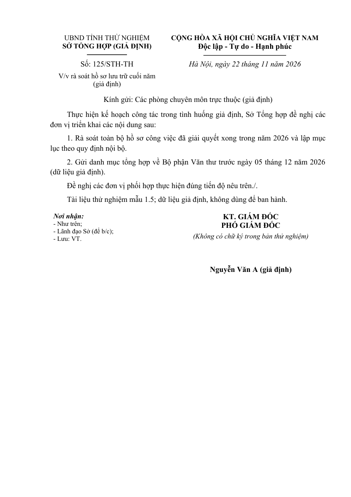
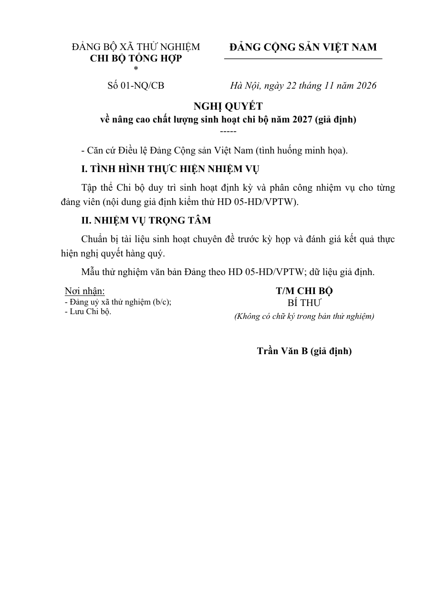
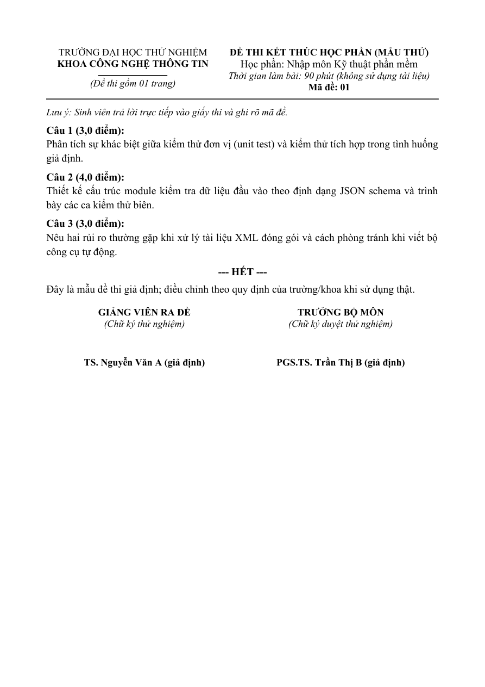
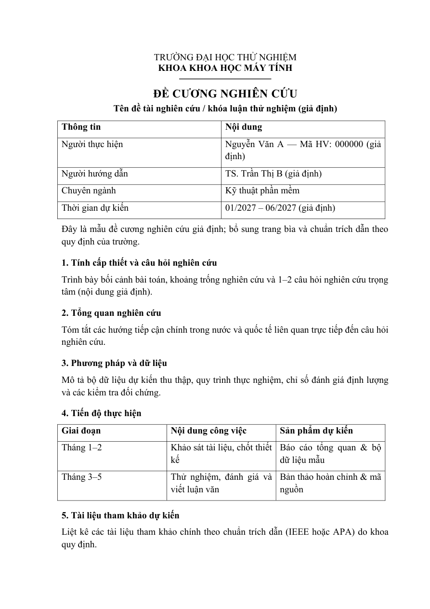
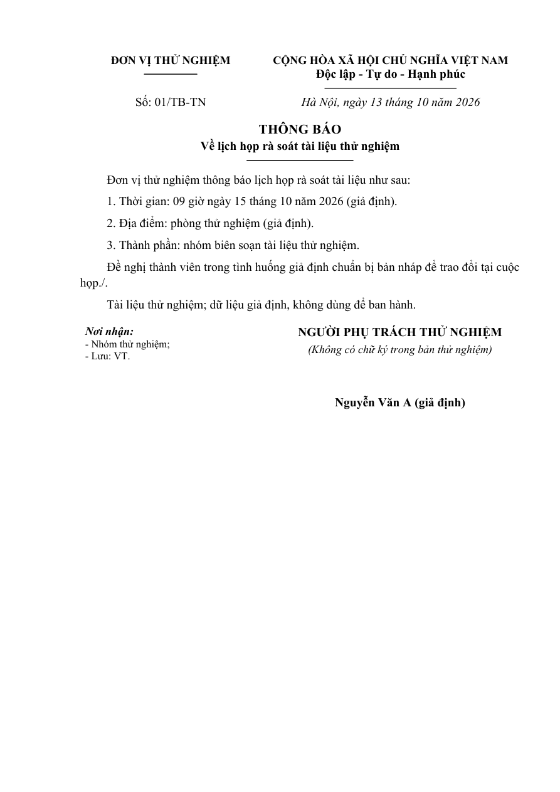

# Vietnamese Docs Style

Skill cho AI agent và bộ công cụ Python (`vndocs`) giúp tạo, điền mẫu và kiểm tra file Word (`.docx`) theo quy ước trình bày Việt Nam — văn bản hành chính NĐ 30/2020/NĐ-CP, văn bản Đảng, VBQPPL, báo cáo học thuật và tài liệu văn phòng.

*Agent skill and local Python CLI (`vndocs`) for generating, template-filling, and validating Vietnamese `.docx` documents under Decree 30/2020/NĐ-CP administrative, Communist Party (QĐ 399-QĐ/TW & HD 05-HD/VPTW), legal-normative, academic, and office conventions.*

[](https://github.com/bGiaHuy/vietnamese-docs-style/releases/latest)
[](https://github.com/bGiaHuy/vietnamese-docs-style/actions/workflows/tests.yml)
[](https://github.com/bGiaHuy/vietnamese-docs-style/actions/workflows/lint.yml)
[](evals/BENCHMARK.md)
[](LICENSE)
[](pyproject.toml)
[](#cách-bắt-đầu)
[](#tương-thích-ai-agent)

**Trạng thái:** `v0.3.0` (`93/93` automated tests pass trên Python `3.10` và `3.12`) · **Giấy phép:** [MIT](LICENSE) · **Tải nhanh:** [`vietnamese-docx.zip`](https://github.com/bGiaHuy/vietnamese-docs-style/releases/latest) (GitHub Releases), cài skill qua `npx skills add bGiaHuy/vietnamese-docs-style`, hoặc cài từ source code (`pip install -e .`).

**Ngôn ngữ / Language:** [Tiếng Việt](#tiếng-việt) | [English](#english)

---

# Tiếng Việt

## Ví dụ

Ảnh dưới là kết quả render (`vndocs render --png` bằng LibreOffice và PyMuPDF) từ **Thông báo hành chính 2 trang do skill tạo ra với dữ liệu giả định**:

| Trang 1 — Header NĐ30, căn cứ và bảng lặp tiêu đề | Trang 2 — Số trang `2` căn giữa, nơi nhận và khối ký |
| :---: | :---: |
|  |  |

Tệp nguồn vượt qua `validate_docx.py --profile administrative` với 0 lỗi (không tạo chữ ký hay con dấu giả). Chi tiết thông số trình bày và kết quả đối chiếu với văn bản thật nằm ở [evals/audit-comparison.md](evals/audit-comparison.md).

<details>
<summary>Xem thêm 4 starter: Công văn NĐ30, Nghị quyết Đảng, Đề thi, Đề cương nghiên cứu</summary>

| Công văn NĐ30 (`administrative-dispatch`) | Nghị quyết Đảng (`party-resolution`, HD 05-HD/VPTW) |
| :---: | :---: |
|  |  |

| Đề thi (`exam-paper`) | Đề cương nghiên cứu (`thesis-research-outline`) |
| :---: | :---: |
|  |  |

Cả 4 starter đều điền dữ liệu giả định, vượt qua `validate_docx.py` với `0` lỗi và giữ tách biệt từng nhóm thể thức.

</details>

<details>
<summary>So sánh trước và sau</summary>

| File Word mặc định (`before-naive`) | Starter NĐ30 đã kiểm tra (`after-audit-notice`) |
| :---: | :---: |
|  |  |
| **`validate_docx.py` → `fail` (4 lỗi):** sai khổ giấy sang US Letter, lề mặc định Word, font Calibri theme, gạch ngang `---` và thiếu bố cục `Số:`/`Ngày`, `Nơi nhận:`. | **`validate_docx.py` → `pass` (0 lỗi):** đúng khổ A4, lề chuẩn NĐ30, Times New Roman `#000000`, `Số:`/`Ngày` thẳng hàng và khối `Nơi nhận:`/ký tách rõ ràng. |

Xem thêm đối chiếu với 2 văn bản `.docx` thật (**UBND xã Hương Khê, Hà Tĩnh 11/2026** và **Cục Quản lý đăng ký kinh doanh Mẫu 27, 2025**) tại [evals/audit-comparison.md](evals/audit-comparison.md).

</details>

## Giới thiệu ngắn

Khi LLM hoặc script Python tự tạo một file `.docx` mới mà không được cấu hình định dạng phù hợp với văn bản của nước ta, file thường rơi về khổ US Letter, lề `2.54 cm`, font Calibri hoặc Arial và tiêu đề màu xanh mặc định của Word. Nhiều prompt còn khiến AI áp nhầm Quốc hiệu, Tiêu ngữ của Nghị định 30/2020/NĐ-CP vào báo cáo học thuật hoặc thông báo công ty.

`vietnamese-docs-style` tách thành hai phần. Bộ hướng dẫn theo ngữ cảnh ([SKILL.md](SKILL.md), [AGENTS.md](AGENTS.md), `references/`) giúp agent chọn đúng thể thức ngay từ đầu. Đi kèm là CLI `vndocs` để tạo file, điền mẫu giữ nguyên XML gốc, validate và render ảnh từng trang.

## Tính năng chính

- Chọn thể thức phù hợp với loại văn bản và nơi tiếp nhận thông qua 8 profile, hỗ trợ văn bản hành chính theo NĐ30/2020, văn bản của Đảng (QĐ 399-QĐ/TW, HD 05-HD/VPTW), VBQPPL (NĐ 187/2025/NĐ-CP), tài liệu học thuật và tài liệu doanh nghiệp.
- Sinh file `.docx` đa profile từ JSON đúng [JSON Schema](assets/schemas/document-input.schema.json) (`vndocs generate ... --validate`), điền token `{{name}}` (`vndocs fill`) hoặc vá vị trí xác minh bằng `vndocs edit --source-sha256`, giữ nguyên XML ngoài vùng sửa.
- Chỉnh sửa bố cục `.docx` hiện có theo quy trình 4 bước (`vndocs map` -> đối chiếu ảnh/`--annotate-marks` -> `vndocs layout-edit` với 13 op có `--track-changes` và bảo toàn namespace Word 365 -> `vndocs diff-layout` đo PDF trước/sau), kèm `vndocs paginate` tự co gọn bố cục đúng chuẩn profile (gom chữ ký rơi lẻ sang trang cuối hoặc ép vừa số trang) mà không sửa bất kỳ từ nào (`xml_ntpr == 1.0`).
- Soi nhanh file mẫu và phát hiện lỗi encoding `Ð` (`U+00D0` -> `Đ` `U+0110`), `kính giửi` hoặc placeholder sót qua `vndocs inspect`; kiểm tra khổ giấy, lề, font/màu kế thừa, style role và numbering qua `vndocs validate`.
- Render PDF và PNG từng trang bằng LibreOffice + PyMuPDF trong profile tạm (`vndocs render --png`, hỗ trợ cache PDF theo `SHA-256` qua `--cache-dir` và tùy chọn `--renderer word-win` trên máy Windows có Microsoft Word) để kiểm tra hiển thị thực tế trước khi bàn giao.
- Kèm bộ câu hỏi phỏng vấn ([interview-questions.md](references/interview-questions.md)), hướng dẫn xem trước Markdown ([markdown-preview-fallback.md](references/markdown-preview-fallback.md)), chỉ mục [llms.txt](llms.txt) và đóng gói thành file ZIP (`vndocs package`).

### Các profile được hỗ trợ

| Profile | Nhóm tài liệu | Rule & Validator | Starter template / Cấu hình tham chiếu |
| --- | --- | --- | --- |
| `administrative` | Thông báo, công văn, quyết định, tờ trình thuộc NĐ30/2020 ([29 loại & ký hiệu](references/administrative-doc-types-nd30.md), [văn phong](references/administrative-writing-style.md)) | Đầy đủ | [`administrative-notice`](assets/templates/administrative-notice.docx), [`administrative-dispatch`](assets/templates/administrative-dispatch.docx) (Mẫu 1.4, 1.5 NĐ30); VBQPPL dùng kèm [`legal-normative.json`](assets/rules/legal-normative.json) ([tham chiếu](references/legal-normative-documents.md)) |
| `party` | Văn bản của Đảng theo QĐ 399-QĐ/TW & HD 05-HD/VPTW ([tham chiếu](references/party-documents.md)) | Builder & validator | [`party-resolution`](assets/templates/party-resolution.docx) |
| `academic` | Báo cáo học thuật, tiểu luận, nghiên cứu, đề cương, đề thi | Đầy đủ | [`academic-short-report`](assets/templates/academic-short-report.docx), [`exam-paper`](assets/templates/exam-paper.docx), [`thesis-research-outline`](assets/templates/thesis-research-outline.docx) |
| `minutes-general` | Biên bản họp nhóm, họp nội bộ doanh nghiệp | Đầy đủ | [`office-minutes`](assets/templates/office-minutes.docx) |
| `office` | Thông báo, ghi nhớ, báo cáo nội bộ văn phòng | Builder & validator | Dựng qua `build_docx` hoặc mẫu tổ chức |
| `proposal` | Đề xuất dự án, kế hoạch công việc | Builder & validator | Dựng qua `build_docx` hoặc mẫu tổ chức |
| `minutes-administrative` | Biên bản thủ tục hành chính cụ thể | Rule lề/font/số trang | Chọn mẫu đúng thủ tục thực tế |
| `custom` | Biểu mẫu `.docx` riêng của trường/cơ quan/công ty | Giữ mẫu; kiểm theo `--config` | Người dùng cung cấp ([ví dụ config](assets/rules/custom-example.json)) |

### Benchmark: Baseline 0/8 vs. Skill 8/8

Benchmark gồm **16 test case**, chạy bằng `python evals/run_validation_benchmark.py` (8 file baseline mặc định vs. 8 đầu ra dùng skill). Kết quả đo hành vi của bộ công cụ `validate_docx.py`, không phải đánh giá chất lượng sinh văn bản của từng mô hình LLM:

| Hạng mục kiểm tra (`validate_docx.py`) | Baseline mặc định | Đầu ra dùng Skill |
| --- | :---: | :---: |
| **Tổng số case đạt `pass`** | **0 / 8 (0%)** | **8 / 8 (100%)** |
| Khổ giấy & lề hành chính NĐ30 (`administrative`, `minutes-administrative`) | 0 / 3 pass (`margin`, `page`) | 0 lỗi |
| Văn bản của Đảng (`party` — HD 05-HD/VPTW vs. áp nhầm lề NĐ30) | 0 / 1 pass (`margin`) | 1 / 1 pass |
| VBQPPL (`administrative` + `legal-normative.json` — NĐ 187/2025) | 0 / 1 pass (`margin`) | 1 / 1 pass |
| Font & màu chữ (`font`, `color`) | 2/2 case gán sai bị bắt | 0 lỗi |
| Placeholder sót / `numId` hỏng (`placeholder`, `numbering`) | 3/3 case lỗi bị bắt | 0 lỗi |

Xem bảng đầy đủ, file JSON cho CI và đối chiếu văn bản thật tại: [`evals/BENCHMARK.md`](evals/BENCHMARK.md) · [`evals/benchmark-results.json`](evals/benchmark-results.json) · [`evals/audit-comparison.md`](evals/audit-comparison.md) · [`evals/manual-results.md`](evals/manual-results.md).

### Benchmark chỉnh sửa bố cục (Vibe Docs): 30/30 Oracle Hit & `xml_ntpr = 1.0`

Bộ benchmark phân tầng **30 ca (`T01`–`T30`)** trên văn bản ngắn/trung bình/dài (`short: 14`, `medium: 10`, `long: 6`), chạy tái lập bằng `python evals/run_vibe_edit_benchmark.py --run-oracle`:

- **Kết quả oracle (`vndocs`):** **30 / 30 (100.0%)** đạt mọi checkpoint hình học PDF + OOXML, **100%** bảo toàn cấu trúc XML ngoài vùng sửa (`xml_ntpr = 1.0`), **4 / 4** ca rủi ro/mơ hồ từ chối an toàn (kể cả `.docx` đã ký số `T28` và ảnh crop không phân biệt được `T17`).
- **Giảm payload ngữ cảnh (`vndocs map` vs `word/document.xml` thô):** giảm trung bình **90.1%** (`short`), **96.9%** (`medium`) và **98.0%** (`long`). Chi tiết nằm ở [`evals/VIBE-BENCHMARK.md`](evals/VIBE-BENCHMARK.md).

## Cách bắt đầu

**Yêu cầu hệ thống:** Node.js/npm (nếu cài skill bằng `npx skills`) và Python `3.10+` (`python-docx`, `PyMuPDF`, `lxml` cài tự động cho bộ công cụ `vndocs`). LibreOffice chỉ cần khi xuất PDF/PNG bằng `vndocs render`.

### Dùng ngay trên Claude.ai / ChatGPT / Gemini (không cần cài CLI)

- Tải [`vietnamese-docx.zip`](https://github.com/bGiaHuy/vietnamese-docs-style/releases/latest) để nạp skill lên Claude hoặc tải lên khung chat có hỗ trợ chạy Python.
- Hoặc dán link `https://raw.githubusercontent.com/bGiaHuy/vietnamese-docs-style/main/llms.txt` vào prompt để AI tự đọc quy chuẩn và mẫu tương ứng.

### Cài và cập nhật skill qua `npx skills`

```bash
# Cài skill
npx skills add bGiaHuy/vietnamese-docs-style

# Kiểm tra bản cập nhật
npx skills check

# Cập nhật các skill đã cài
npx skills update
```

### Cài bộ công cụ Python `vndocs` từ source code

```bash
git clone https://github.com/bGiaHuy/vietnamese-docs-style.git
cd vietnamese-docs-style
python -m pip install -e .
# Nếu chỉ chạy trực tiếp `python scripts/...py` và không dùng `vndocs`:
# python -m pip install -r requirements.txt
vndocs doctor
```

### Tương thích AI Agent

| AI Agent / IDE | Tệp cấu hình trong repo | Cách tích hợp |
| --- | --- | --- |
| **Claude Code** | [SKILL.md](SKILL.md) | Đọc `SKILL.md` trong repo hoặc cài từ ZIP đóng gói qua `vndocs package --output dist/vietnamese-docx.zip` |
| **OpenAI Codex** | [AGENTS.md](AGENTS.md), [SKILL.md](SKILL.md) | Tự đọc `AGENTS.md` ở thư mục gốc và nạp `SKILL.md` theo nhu cầu |
| **Cursor** | [AGENTS.md](AGENTS.md), [SKILL.md](SKILL.md) | Mở repo làm workspace để nhận `AGENTS.md`, hoặc gắn `SKILL.md` vào rule/context |
| **Gemini CLI** | [SKILL.md](SKILL.md), [AGENTS.md](AGENTS.md) | Cài qua `npx skills add bGiaHuy/vietnamese-docs-style` hoặc đọc `SKILL.md` / `references/` |
| **Antigravity** | [SKILL.md](SKILL.md), [AGENTS.md](AGENTS.md) | Cài qua `npx skills` hoặc nhận diện tự động `SKILL.md` / `AGENTS.md` tại thư mục gốc |
| **GitHub Copilot (VS Code)** | [AGENTS.md](AGENTS.md), [SKILL.md](SKILL.md) | Đọc hướng dẫn repo qua `AGENTS.md` / `SKILL.md` trong workspace |
| **Windsurf** | [AGENTS.md](AGENTS.md), [SKILL.md](SKILL.md) | Mở workspace chứa `AGENTS.md` và trỏ agent tới `SKILL.md` |
| **OpenCode / Cline / Roo Code** | [AGENTS.md](AGENTS.md), [SKILL.md](SKILL.md) | Đọc chuẩn `AGENTS.md` ở gốc repo và gọi lệnh `vndocs` |

## Cách sử dụng

### Chạy thử bộ demo

```bash
vndocs demo --output-dir artifacts/demo
vndocs validate artifacts/demo/office-filled.docx --profile minutes-general
vndocs render artifacts/demo/office-filled.docx --png
```

### Thao tác thường dùng với CLI và Agent

- **Sinh DOCX từ JSON đa profile + tự kiểm tra ngay:**
  ```bash
  vndocs generate assets/schemas/examples/nd30-dispatch.json artifacts/cong-van.docx --validate
  vndocs generate assets/schemas/examples/party-resolution.json artifacts/nq-chibo.docx --validate
  ```
- **Soi mẫu cơ quan và chuẩn hóa ký tự `Ð` (`U+00D0` -> `Đ`) giữ nguyên XML khác:**
  ```bash
  vndocs inspect source.docx --normalize-output artifacts/clean-template.docx
  ```
- **Điền starter có sẵn (`{{token}}`):**
  ```bash
  vndocs fill assets/templates/administrative-notice.docx artifacts/notice.docx --values assets/templates/administrative-notice.values.json
  vndocs validate artifacts/notice.docx --profile administrative --config assets/templates/administrative-notice.rules.json
  ```
- **Sửa giữ nguyên mẫu có sẵn không dùng token:**
  ```bash
  vndocs edit source.docx artifacts/edited.docx --edits slots.json --source-sha256 <SHA256>
  ```
- **Chỉnh bố cục bảng/ảnh/đoạn/trang và đo lại bằng PDF (`map` -> `layout-edit` / `paginate` -> `diff-layout`):**
  ```bash
  vndocs map source.docx --format markdown
  vndocs layout-edit source.docx artifacts/scaled.docx --plan plan.json --track-changes
  vndocs diff-layout source.docx artifacts/scaled.docx --target <ANCHOR> --cache-dir .vndocs-cache
  vndocs paginate source.docx artifacts/onepage.docx --fix-orphan-signature --profile administrative
  ```
- **Prompt mẫu gửi AI Agent:**
  - *Hành chính:* `Tạo file DOCX thông báo lịch họp theo thể thức NĐ30/2020; chỗ nào thiếu thông tin ký hoặc số văn bản thì đánh dấu [CẦN BỔ SUNG: ...].`
  - *Học thuật:* `Viết báo cáo học thuật ngắn về ứng dụng AI trong giáo dục (chưa có mẫu trường), không tự thêm số liệu nghiên cứu.`
  - *Biên bản họp:* `Chuyển ghi chú họp sau thành biên bản họp nội bộ gồm thảo luận, quyết định đã chốt và bảng phân công.`
  - *Mẫu riêng:* `Điền dữ liệu vào mẫu DOCX đính kèm và giữ nguyên style, bảng, header/footer ngoài vùng sửa.`

Danh sách đầy đủ subcommand, cấu hình JSON và exit codes (`0` pass, `1` fail, `2` partial) nằm tại [references/tooling.md](references/tooling.md).

## Giới hạn và tích hợp

- **Cài đặt LibreOffice (khuyến nghị để render PDF/PNG đa nền tảng):**
  - Windows: `winget install TheDocumentFoundation.LibreOffice` (hoặc tùy chọn `--renderer word-win` nếu máy Windows đã cài Microsoft Word desktop; Word COM không sẵn có trên môi trường Linux/CI hoặc máy Windows chưa cài Word)
  - macOS: `brew install --cask libreoffice`
  - Ubuntu / Debian: `sudo apt-get update && sudo apt-get install -y libreoffice-writer fonts-liberation`
  - Nếu `soffice` không có trong `PATH`, truyền `--renderer` hoặc đặt biến môi trường `VNDOCS_RENDERER`.
- **Tài khoản và quota:** CLI `vndocs` và toàn bộ script trong `scripts/` chạy offline trên máy, không cần API key hay tài khoản. Khi chạy qua AI Agent, lượng token sử dụng phụ thuộc vào gói tài khoản hoặc API của agent bạn đang dùng.
- **Phạm vi chưa hỗ trợ:**
  - `validate_docx.py` không chứng nhận hợp lệ pháp lý hay tính chính xác của dữ liệu; văn bản hành chính chính thức vẫn cần người chịu trách nhiệm kiểm tra trước khi phát hành.
  - Công cụ từ chối sửa các file `.docx` đã ký số (`_xmlsignatures/`) và không tạo chữ ký hay con dấu giả.
  - Phần `unchecked` trong báo cáo kiểm tra gồm: theme font/color phức tạp, conditional table style, text box, chart, footnote/endnote, tracked revisions và tính đúng của thứ tự đánh số/cập nhật field.

## Dữ liệu và quyền riêng tư

- `vndocs` chạy local, không gửi telemetry hay dữ liệu lên server. Đầu ra mặc định lưu trong `artifacts/`, `dist/` và cache render `.vndocs-cache/` (đều đã nằm trong `.gitignore`); khi render, LibreOffice chạy với profile tạm trên máy.
- Nếu bạn sử dụng skill thông qua AI Agent chạy trên đám mây, nội dung prompt tuân theo chính sách dữ liệu của nhà cung cấp mô hình đó — không dán tài liệu mật hoặc thông tin nhạy cảm chưa được phép lên dịch vụ ngoài.

## Thông tin cho người đóng góp

- **Công nghệ chính:** Python 3.10+, `python-docx`, `lxml`, `PyMuPDF`, LibreOffice (render), `pytest`, `ruff`.
- **Cài môi trường dev và chạy bộ kiểm tra:**
  ```bash
  python -m pip install -e ".[dev]"
  python -m ruff check .
  python -m compileall -q scripts tests evals
  python -m pytest -q
  python evals/run_validation_benchmark.py
  python evals/run_vibe_edit_benchmark.py --run-oracle
  ```
- **Báo lỗi và đóng góp:** Mở issue tại [GitHub Issues](https://github.com/bGiaHuy/vietnamese-docs-style/issues) hoặc gửi Pull Request theo hướng dẫn tại [CONTRIBUTING.md](CONTRIBUTING.md).

<details>
<summary>Cấu trúc thư mục chính của repository</summary>

```text
vietnamese-docs-style/
├── README.md                  # Tài liệu chính (Việt / Anh)
├── LICENSE                    # Giấy phép MIT
├── CONTRIBUTING.md            # Hướng dẫn review và đóng góp
├── pyproject.toml             # Đóng gói PEP 621 & CLI `vndocs`
├── SKILL.md                   # Hướng dẫn chính cho AI Agent
├── AGENTS.md                  # Quy tắc chung cho Codex, Cursor, Copilot, Windsurf, OpenCode
├── llms.txt                   # Chỉ mục tài liệu & thứ tự đọc cho web/sandbox agents
├── requirements.txt           # Runtime dependencies
├── requirements-dev.txt       # Dev/CI dependencies (pytest, PyYAML, ruff)
├── assets/                    # Starter templates, JSON Schema, ví dụ đầu vào & custom rules
├── docs/images/               # Ảnh preview Before/After và đầu ra tạo bằng skill
├── docs/internal/             # Hồ sơ triển khai và nghiệm thu nội bộ
├── evals/                     # Benchmark tái lập, báo cáo audit & Vibe Docs 30-case eval
├── references/                # Tài liệu quy chuẩn NĐ30, văn bản Đảng, VBQPPL, học thuật, biên bản, tooling
├── scripts/                   # Package Python & CLI `vndocs`
└── tests/                     # 93 automated tests (pytest + LibreOffice render)
```

</details>

## Credits và giấy phép

- **Tác giả:** Bùi Gia Huy ([bGiaHuy](https://github.com/bGiaHuy)) · [vietnamese-docs-style](https://github.com/bGiaHuy/vietnamese-docs-style).
- **Đóng góp:**
  - Cảm ơn [@triensslci](https://github.com/triensslci) đã đóng góp profile `party` cùng bộ tài liệu quy chuẩn văn bản của Đảng ([party-documents.md](references/party-documents.md) theo QĐ 399-QĐ/TW và HD 05-HD/VPTW), văn bản quy phạm pháp luật ([legal-normative-documents.md](references/legal-normative-documents.md), [legal-normative.json](assets/rules/legal-normative.json) theo Luật 64/2025, Luật 87/2025, NĐ 78/2025 và Phụ lục I NĐ 187/2025), danh mục 29 loại văn bản hành chính & thẩm quyền ký NĐ30 ([administrative-doc-types-nd30.md](references/administrative-doc-types-nd30.md)) và hướng dẫn văn phong hành chính – công vụ ([administrative-writing-style.md](references/administrative-writing-style.md)).
  - Cảm ơn [@kanazawahere/nd30](https://github.com/kanazawahere/nd30) (giấy phép MIT) và nguồn nghiệp vụ gốc [biencuong/vbhc](https://github.com/biencuong/vbhc) (Unlicense) về ý tưởng sinh `.docx` từ JSON Schema (`vndocs generate`), soi mẫu & phát hiện lỗi encoding `Ð` (`U+00D0`) (`vndocs inspect`), bộ câu hỏi phỏng vấn ([interview-questions.md](references/interview-questions.md)), hướng dẫn xem trước Markdown ([markdown-preview-fallback.md](references/markdown-preview-fallback.md)) và chỉ mục [llms.txt](llms.txt).
- **Quy chuẩn và thư viện sử dụng:** Đối chiếu thể thức từ **Nghị định 30/2020/NĐ-CP**, **Quy định 399-QĐ/TW**, **Hướng dẫn 05-HD/VPTW** và **Nghị định 187/2025/NĐ-CP**; xây dựng trên `python-docx`, `lxml`, `PyMuPDF` và `LibreOffice`.
- **Giấy phép:** Mã nguồn, script và tài liệu của dự án dùng giấy phép **MIT** ([LICENSE](LICENSE)). Các văn bản, biểu mẫu tham khảo của bên thứ ba giữ nguyên bản quyền và điều khoản gốc của đơn vị ban hành.

---

# English

## Example

LibreOffice renders (`vndocs render --png`) of a **2-page Vietnamese administrative notice generated with the skill and simulated data**:

| Page 1 — NĐ30 Header, Legal Bases & Repeating Table Header | Page 2 — Centered Top Page `2` & Recipients / Signer Block |
| :---: | :---: |
|  |  |

`validate_docx.py --profile administrative` passes with 0 errors and zero fabricated signatures or stamps. Detailed layout metrics and real-world document comparisons are in [evals/audit-comparison.md](evals/audit-comparison.md).

<details>
<summary>More starters: ND30 Dispatch, Party Resolution, Exam Paper, Research Outline</summary>

| ND30 Dispatch (`administrative-dispatch`) | Party Resolution (`party-resolution`, HD 05-HD/VPTW) |
| :---: | :---: |
|  |  |

| Exam Paper (`exam-paper`) | Research Outline (`thesis-research-outline`) |
| :---: | :---: |
|  |  |

All 4 starters pass `validate_docx.py` with 0 errors on dummy inputs while keeping each document family separate.

</details>

## Overview

Out of the box, LLMs and Python DOCX scripts default to US Letter pages, `2.54 cm` margins, Calibri or Arial fonts, blue Word headings, or force Decree 30/2020/NĐ-CP headers onto academic essays and private company notices.

`vietnamese-docs-style` has two parts: context-routed instructions ([SKILL.md](SKILL.md), [AGENTS.md](AGENTS.md), `references/`) so agents choose the right format first, and the `vndocs` CLI to generate, template-fill cleanly, validate, and render `.docx` files.

## Key Features

- Context-routed formatting across 8 profiles (`administrative`, `party`, `academic`, `minutes-general`, `office`, `proposal`, `minutes-administrative`, `custom`) plus [`legal-normative.json`](assets/rules/legal-normative.json), keeping Decree 30/2020/NĐ-CP, Party guidelines (QĐ 399-QĐ/TW & HD 05-HD/VPTW), academic reports, and corporate minutes separated.
- Declarative multi-profile JSON generation (`vndocs generate --validate`, [JSON Schema](assets/schemas/document-input.schema.json)), `{{token}}` template filling (`vndocs fill`), and SHA256-verified slot patching (`vndocs edit`) preserving untouched ZIP members.
- Controlled Vibe Docs layout editing on existing `.docx` files (`vndocs map` -> screenshot/Set-of-Mark `--annotate-marks` grounding -> `vndocs layout-edit` across 13 ops with optional `--track-changes` & Word 365 namespace preservation -> `vndocs diff-layout`), plus profile-safe auto-pagination (`vndocs paginate`) to absorb orphan signature blocks or meet target page budgets without modifying text (`xml_ntpr == 1.0`).
- Template inspection and lossless `Ð` (`U+00D0` -> `Đ` `U+0110`) encoding normalization (`vndocs inspect --normalize-output`), plus structural and style validation (`vndocs validate`) with an explicit `unchecked` list.
- PDF and PNG page rendering (`vndocs render --png`, with SHA-256 PDF caching via `--cache-dir` and optional Windows Word COM backend via `--renderer word-win`) via LibreOffice in a temporary profile.
- Root agent sitemap ([llms.txt](llms.txt)), interview checklist ([interview-questions.md](references/interview-questions.md)), Markdown layout fallback ([markdown-preview-fallback.md](references/markdown-preview-fallback.md)), and skill ZIP packaging (`vndocs package`).

## Getting Started & Agent Support

Requires Node.js/npm (for `npx skills`) and Python `3.10+` (`python-docx`, `PyMuPDF`, `lxml` for the local `vndocs` CLI); LibreOffice is optional and only needed for `vndocs render`.

**Web chat (zero install):** Download [`vietnamese-docx.zip`](https://github.com/bGiaHuy/vietnamese-docs-style/releases/latest) to upload as a skill/bundle, or share `https://raw.githubusercontent.com/bGiaHuy/vietnamese-docs-style/main/llms.txt` in chat.

```bash
# Install the skill
npx skills add bGiaHuy/vietnamese-docs-style

# Check for updates
npx skills check

# Update installed skills
npx skills update
```

To install the local Python `vndocs` CLI from source:

```bash
git clone https://github.com/bGiaHuy/vietnamese-docs-style.git
cd vietnamese-docs-style
python -m pip install -e .
# Or install runtime deps directly without the `vndocs` CLI:
# python -m pip install -r requirements.txt
vndocs doctor
```

| AI Agent / IDE | Entry files | Integration |
| --- | --- | --- |
| **Claude Code** | [SKILL.md](SKILL.md) | Point to `SKILL.md` or install the ZIP built by `vndocs package` |
| **OpenAI Codex / Cursor / Copilot / Windsurf / OpenCode** | [AGENTS.md](AGENTS.md), [SKILL.md](SKILL.md) | Open the repo as workspace (`AGENTS.md` auto-discovered) and invoke `vndocs` |
| **Gemini CLI / Antigravity** | [SKILL.md](SKILL.md), [AGENTS.md](AGENTS.md) | Install via `npx skills add bGiaHuy/vietnamese-docs-style` or load `SKILL.md` / `AGENTS.md` |

## Usage

```bash
vndocs demo --output-dir artifacts/demo
vndocs validate artifacts/demo/office-filled.docx --profile minutes-general
vndocs render artifacts/demo/office-filled.docx --png
```

Common workflows also include `vndocs generate ... --validate`, `vndocs inspect --normalize-output ...`, `vndocs fill`, `vndocs edit --source-sha256 ...`, `vndocs map`, `vndocs layout-edit --track-changes`, `vndocs diff-layout --cache-dir ...`, `vndocs paginate`, `vndocs templates`, and `vndocs package` (or calling `python scripts/<tool>.py`). See [references/tooling.md](references/tooling.md) for JSON rule keys, all 13 layout ops, and exit codes (`0` pass, `1` fail, `2` partial).

### Benchmark: 0/8 Baseline vs. 8/8 Skill

16 deterministic test cases (8 naive/misapplied baselines vs. 8 skill-guided outputs), run via `python evals/run_validation_benchmark.py`. Measures `validate_docx.py` tooling checks rather than multi-LLM prompt accuracy:

- **Result:** `0 / 8` baseline pass vs. `8 / 8` skill pass (checked continuously in CI).
- **Details:** [`evals/BENCHMARK.md`](evals/BENCHMARK.md) · [`evals/benchmark-results.json`](evals/benchmark-results.json) · [`evals/audit-comparison.md`](evals/audit-comparison.md) · [`evals/manual-results.md`](evals/manual-results.md).

### Layout Editing Benchmark (Vibe Docs): 30/30 Oracle Hit & `xml_ntpr = 1.0`

30 stratified DOCX layout cases (`T01`–`T30`; `short: 14`, `medium: 10`, `long: 6`), run via `python evals/run_vibe_edit_benchmark.py --run-oracle`:

- **Oracle (`vndocs`):** **30 / 30 (100.0%)** pass every PDF geometry & OOXML checkpoint with **100%** non-target XML preservation (`xml_ntpr = 1.0`) and **4 / 4** safe fail-closed refusals (including signed `.docx` `T28` and indistinguishable crops `T17`).
- **Static payload reduction (`vndocs map` vs raw `word/document.xml`):** **90.1%** (`short`), **96.9%** (`medium`), **98.0%** (`long`). See [`evals/VIBE-BENCHMARK.md`](evals/VIBE-BENCHMARK.md).

## Limitations & Integrations

- **LibreOffice (recommended cross-platform renderer) & optional Word COM:** `winget install TheDocumentFoundation.LibreOffice` (Windows), `brew install --cask libreoffice` (macOS), or `sudo apt-get install -y libreoffice-writer fonts-liberation` (Ubuntu/Debian); override via `--renderer` or `VNDOCS_RENDERER`. `--renderer word-win` is optional on Windows hosts that have desktop Microsoft Word installed (unavailable on Linux/CI or hosts without Office COM registered).
- **Accounts & Quotas:** `vndocs` runs offline with zero API keys or accounts. Agent execution uses whichever model subscription or quota you configure in your agent client.
- **Unsupported / uncertified scope:** Not a legal compliance certificate; refuses editing digitally signed `_xmlsignatures/` files; never fabricates signatures or stamps; leaves theme fonts/colors, conditional table styles, text boxes, charts, footnotes, and tracked revisions in `unchecked`. Human review is required before official issuance.

## Data & Privacy

- `vndocs` runs locally and sends no telemetry or data to external servers. Local outputs go to gitignored `artifacts/`, `dist/`, and `.vndocs-cache/`, and LibreOffice renders in an isolated temp directory.
- When using cloud-hosted AI agents, prompt text is governed by that provider's privacy terms — avoid sending confidential records without authorization.

## Contributing

- **Stack:** Python 3.10+, `python-docx`, `lxml`, `PyMuPDF`, LibreOffice, `pytest`, `ruff`.
- **Checks:**
  ```bash
  python -m pip install -e ".[dev]"
  python -m ruff check .
  python -m compileall -q scripts tests evals
  python -m pytest -q
  python evals/run_validation_benchmark.py
  python evals/run_vibe_edit_benchmark.py --run-oracle
  ```
- Report bugs or submit PRs via [GitHub Issues](https://github.com/bGiaHuy/vietnamese-docs-style/issues) following [CONTRIBUTING.md](CONTRIBUTING.md).

## Credits & License

- **Author:** Bùi Gia Huy ([bGiaHuy](https://github.com/bGiaHuy)) · [vietnamese-docs-style](https://github.com/bGiaHuy/vietnamese-docs-style).
- **Contributors:**
  - Special thanks to [@triensslci](https://github.com/triensslci) for contributing the `party` profile and reference guides for Communist Party documents ([party-documents.md](references/party-documents.md) per QĐ 399-QĐ/TW & HD 05-HD/VPTW), legal-normative documents ([legal-normative-documents.md](references/legal-normative-documents.md) and [legal-normative.json](assets/rules/legal-normative.json) per Laws 64/2025 & 87/2025, Decrees 78/2025 & 187/2025), the 29 Decree 30/2020/NĐ-CP document types & signing rules ([administrative-doc-types-nd30.md](references/administrative-doc-types-nd30.md)), and administrative writing style guidelines ([administrative-writing-style.md](references/administrative-writing-style.md)).
  - Appreciation to [@kanazawahere/nd30](https://github.com/kanazawahere/nd30) (MIT License) and upstream [biencuong/vbhc](https://github.com/biencuong/vbhc) (Unlicense) for inspiring the declarative JSON-to-DOCX generator workflow (`vndocs generate`), template inspection & `U+00D0` (`Ð -> Đ`) encoding detection (`vndocs inspect`), pre-drafting interview questions ([interview-questions.md](references/interview-questions.md)), Markdown layout fallback ([markdown-preview-fallback.md](references/markdown-preview-fallback.md)), and root [llms.txt](llms.txt) index.
- **Standards & Libraries:** Formatting conventions referenced against Decree 30/2020/NĐ-CP, Regulation 399-QĐ/TW, Guideline 05-HD/VPTW, and Decree 187/2025/NĐ-CP; built on `python-docx`, `lxml`, `PyMuPDF`, and `LibreOffice`.
- **License:** Project-authored source, scripts, and documentation are licensed under the **MIT License** ([LICENSE](LICENSE)). Third-party reference materials remain under their original owners' licenses.
