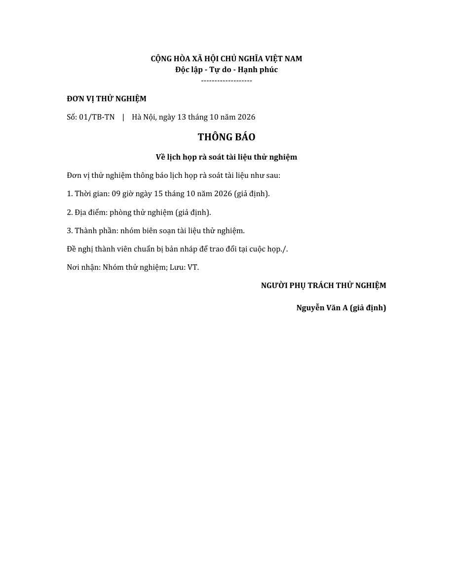

# Vietnamese Docs Style

Skill và bộ công cụ Python (`vndocs`) giúp người dùng AI coding agent, cán bộ hành chính, nhân viên văn phòng, sinh viên và lập trình viên tạo, điền mẫu và kiểm tra file Word (`.docx`) theo đúng quy ước trình bày Việt Nam (Nghị định 30/2020/NĐ-CP, báo cáo học thuật, biên bản họp).

*Agent skill and local Python CLI (`vndocs`) for generating, template-filling, and validating Vietnamese `.docx` documents under Decree 30/2020/NĐ-CP administrative, academic, and office conventions.*

[](https://github.com/bGiaHuy/vietnamese-docs-style/actions/workflows/tests.yml)
[](https://github.com/bGiaHuy/vietnamese-docs-style/actions/workflows/lint.yml)
[](LICENSE)
[](pyproject.toml)
[](#cách-bắt-đầu)
[](#tương-thích-ai-agent)

**Trạng thái:** `v0.2.0` (`42/42` automated tests pass trên Python `3.10` và `3.12`) · **Giấy phép:** [MIT](LICENSE) · **Cài đặt:** chưa đóng gói bản GitHub Release riêng; cài trực tiếp từ mã nguồn (`pip install -e .`) hoặc xuất file ZIP skill qua `vndocs package`.

**Ngôn ngữ / Language:** [Tiếng Việt](#tiếng-việt) | [English](#english)

---

# Tiếng Việt

## Bằng chứng trực quan

Ảnh dưới là kết quả render trực tiếp (`vndocs render --png` bằng LibreOffice và PyMuPDF) từ **Thông báo hành chính 2 trang do skill tạo ra với dữ liệu giả định**:

| Trang 1 — Header NĐ30, căn cứ và bảng lặp tiêu đề | Trang 2 — Số trang `2` căn giữa, nơi nhận và khối ký |
| :---: | :---: |
|  |  |

Tệp nguồn vượt qua `validate_docx.py --profile administrative` với 0 lỗi: khổ A4 (`21.0 × 29.7 cm`), lề NĐ30 (`3.0 / 1.5 / 2.0 / 2.0 cm`), bảng đầu 2×2 giữ `Số:` và `Ngày` cùng hàng ngang, đường kẻ dưới Tiêu ngữ dài `4.95 cm` khớp bề ngang chữ, ẩn số trang ở trang 1 và hiện `2` căn giữa ở đầu trang 2. File minh họa giữ nguyên vùng ký trống, không tạo chữ ký hay con dấu giả.

<details>
<summary>So sánh thêm: file Word mặc định (Before) vs. starter sau audit (After) và đối chiếu văn bản cơ quan nhà nước</summary>

| Mặc định không hướng dẫn (`before-naive`) | Starter NĐ30 sau audit (`after-audit-notice`) |
| :---: | :---: |
|  |  |
| **`validate_docx.py` → `fail` (4 lỗi):** khổ US Letter (`21.59 × 27.94 cm`), lề mặc định (`3.18 / 2.54 cm`), font Calibri theme, dùng dấu `---` làm đường kẻ, thiếu bố cục `Số:`/`Ngày` và `Nơi nhận:`. | **`validate_docx.py` → `pass` (0 lỗi):** khổ A4, lề chuẩn NĐ30, Times New Roman `#000000`, `Số:` và `Ngày` thẳng hàng trong bảng 2×2, đường kẻ Tiêu ngữ `4.95 cm`, ghi chú ký in nghiêng khóa `cantSplit`. |

Xem thêm so sánh Starter Trước/Sau Audit và kết quả chạy validator trên 2 văn bản `.docx` thật tại Việt Nam (**UBND xã Hương Khê, Hà Tĩnh 11/2026** và **Cục Quản lý đăng ký kinh doanh Mẫu 27, 2025**) ở [evals/audit-comparison.md](evals/audit-comparison.md).

</details>

## Giới thiệu ngắn

Khi LLM hoặc script Python tự tạo một file `.docx` mới mà thiếu quy ước địa phương, file thường rơi về khổ US Letter, lề `2.54 cm`, font Calibri hoặc Arial và tiêu đề màu xanh mặc định của Word. Nhiều prompt còn khiến AI áp nhầm Quốc hiệu, Tiêu ngữ của Nghị định 30/2020/NĐ-CP vào báo cáo học thuật hoặc thông báo công ty.

`vietnamese-docs-style` tách rõ hai phần: bộ hướng dẫn theo ngữ cảnh ([SKILL.md](SKILL.md), [AGENTS.md](AGENTS.md), [GEMINI.md](GEMINI.md), `references/`) để agent chọn đúng thể thức ngay từ đầu, đi kèm CLI `vndocs` để dựng file, điền mẫu giữ nguyên XML gốc, kiểm tra định dạng và render ảnh từng trang.

## Tính năng chính

- Chọn đúng thể thức theo loại văn bản và nơi tiếp nhận qua 7 profile; NĐ30/2020 chỉ áp dụng cho văn bản hành chính thuộc phạm vi quy định, không ép lên bài học thuật hay tài liệu nội bộ doanh nghiệp.
- Điền token `{{name}}` (kể cả khi Word tách token qua nhiều run) bằng `vndocs fill` hoặc vá đúng vị trí văn bản bằng `vndocs edit --source-sha256`, giữ nguyên từng byte của các thành phần XML ngoài vùng sửa.
- Kiểm tra khổ giấy, lề từng section, font/màu kế thừa, named style role, placeholder sót (`{{...}}`, `[CẦN BỔ SUNG: ...]`) và tham chiếu numbering qua `vndocs validate`, kèm danh sách `unchecked` cho phần chưa kiểm tra.
- Render PDF và PNG từng trang bằng LibreOffice + PyMuPDF trong profile tạm cô lập (`vndocs render --png`), tránh trường hợp PDF cũ nằm sẵn trên đĩa bị nhận nhầm là bản mới.
- Hỗ trợ dựng tài liệu từ đầu (`scripts/build_docx.py`) với trường số trang `PAGE` thật và đóng gói bản phân phối ZIP gọn sạch (`vndocs package`) không dính dữ liệu nghiên cứu hay test.

### Phạm vi hỗ trợ theo Profile

| Profile | Nhóm tài liệu | Rule & Validator | Starter template sẵn có |
| --- | --- | --- | --- |
| `administrative` | Thông báo, công văn, quyết định thuộc NĐ30/2020 | Đầy đủ | [`administrative-notice`](assets/templates/administrative-notice.docx) (tham chiếu Mẫu 1.4 NĐ30) |
| `academic` | Báo cáo học thuật ngắn, tiểu luận, học phần | Đầy đủ | [`academic-short-report`](assets/templates/academic-short-report.docx) |
| `minutes-general` | Biên bản họp nhóm, họp nội bộ doanh nghiệp | Đầy đủ | [`office-minutes`](assets/templates/office-minutes.docx) |
| `office` | Thông báo, ghi nhớ, báo cáo nội bộ văn phòng | Builder & validator | Dựng qua `build_docx` hoặc mẫu tổ chức |
| `proposal` | Đề xuất dự án, kế hoạch công việc | Builder & validator | Dựng qua `build_docx` hoặc mẫu tổ chức |
| `minutes-administrative` | Biên bản thủ tục hành chính cụ thể | Rule lề/font/số trang | Chọn mẫu đúng thủ tục thực tế |
| `custom` | Biểu mẫu `.docx` riêng của trường/cơ quan/công ty | Giữ mẫu; kiểm theo `--config` | Người dùng cung cấp ([ví dụ config](assets/rules/custom-example.json)) |

<details>
<summary>Benchmark công cụ tái lập: Baseline 0/6 pass vs. Skill-guided 6/6 pass</summary>

Chạy qua `python evals/run_validation_benchmark.py` trên **12 case deterministic** (6 file baseline tạo bằng `python-docx` mặc định vs. 6 đầu ra qua starter/builder/config của skill). Đây là phép đo hành vi cố định của bộ công cụ DOCX, không phải benchmark đo khả năng sinh văn bản của nhiều LLM trên prompt tự nhiên (xem đánh giá thủ công ở [evals/manual-results.md](evals/manual-results.md)).

| Hạng mục kiểm tra (`validate_docx.py`) | Baseline mặc định | Đầu ra dùng Skill |
| --- | :---: | :---: |
| Tổng số case đạt `pass` | **0 / 6** | **6 / 6** |
| Khổ giấy & lề NĐ30 (`page`, `margin`) | 3/3 case hành chính lỗi | 0 lỗi |
| Font & màu chữ (`font`, `color`) | 2/3 case gán sai bị bắt | 0 lỗi |
| Placeholder sót / `numId` hỏng | 3/3 case lỗi bị bắt | 0 lỗi |

</details>

## Cách bắt đầu

**Yêu cầu hệ thống:** Python `3.10+` (`python-docx`, `PyMuPDF`, `lxml` cài tự động). LibreOffice chỉ cần khi xuất PDF/PNG bằng `vndocs render`.

```bash
git clone https://github.com/bGiaHuy/vietnamese-docs-style.git
cd vietnamese-docs-style
python -m pip install -e .
# Nếu chỉ chạy trực tiếp `python scripts/...py` và không dùng `vndocs`:
# python -m pip install -r requirements.txt
vndocs doctor
```

Người dùng cuối không cần cài `requirements-dev.txt`.

### Tương thích AI Agent

| AI Agent / IDE | Tệp cấu hình trong repo | Cách tích hợp |
| --- | --- | --- |
| **Claude Code** | [SKILL.md](SKILL.md) | Đọc `SKILL.md` trong repo hoặc cài từ ZIP đóng gói qua `vndocs package --output dist/vietnamese-docx.zip` |
| **OpenAI Codex** | [AGENTS.md](AGENTS.md), [SKILL.md](SKILL.md) | Tự đọc `AGENTS.md` ở thư mục gốc và nạp `SKILL.md` theo nhu cầu |
| **Cursor** | [AGENTS.md](AGENTS.md), [SKILL.md](SKILL.md) | Mở repo làm workspace để nhận `AGENTS.md`, hoặc gắn `SKILL.md` vào rule/context |
| **Gemini CLI** | [GEMINI.md](GEMINI.md), [SKILL.md](SKILL.md) | Tự nạp `GEMINI.md` ở thư mục gốc và tra cứu `SKILL.md` / `references/` |
| **Antigravity** | [SKILL.md](SKILL.md), [GEMINI.md](GEMINI.md), [AGENTS.md](AGENTS.md) | Nhận diện tự động quy tắc dự án và skill tại thư mục gốc |
| **GitHub Copilot (VS Code)** | [AGENTS.md](AGENTS.md), [SKILL.md](SKILL.md) | Đọc hướng dẫn repo qua `AGENTS.md` / `SKILL.md` trong workspace |
| **Windsurf** | [AGENTS.md](AGENTS.md), [SKILL.md](SKILL.md) | Mở workspace chứa `AGENTS.md` và trỏ agent tới `SKILL.md` |
| **OpenCode / Cline / Roo Code** | [AGENTS.md](AGENTS.md), [SKILL.md](SKILL.md) | Đọc chuẩn `AGENTS.md` ở gốc repo và gọi lệnh `vndocs` |

## Cách sử dụng

### Chạy thử bộ demo

```bash
vndocs demo --output-dir artifacts/demo
vndocs validate artifacts/demo/office-filled.docx --profile minutes-general
vndocs render artifacts/demo/office-filled.docx --png
```

### Thao tác thường dùng với CLI và Agent

- **Điền starter có sẵn (`{{token}}`):**
  ```bash
  vndocs fill assets/templates/administrative-notice.docx artifacts/notice.docx --values assets/templates/administrative-notice.values.json
  vndocs validate artifacts/notice.docx --profile administrative --config assets/templates/administrative-notice.rules.json
  ```
- **Sửa giữ nguyên mẫu có sẵn không dùng token:**
  ```bash
  vndocs edit source.docx artifacts/edited.docx --edits slots.json --source-sha256 <SHA256>
  ```
- **Prompt mẫu gửi AI Agent:**
  - *Hành chính:* `Tạo file DOCX thông báo lịch họp theo thể thức NĐ30/2020; chỗ nào thiếu thông tin ký hoặc số văn bản thì đánh dấu [CẦN BỔ SUNG: ...].`
  - *Học thuật:* `Viết báo cáo học thuật ngắn về ứng dụng AI trong giáo dục (chưa có mẫu trường), không tự thêm số liệu nghiên cứu.`
  - *Biên bản họp:* `Chuyển ghi chú họp sau thành biên bản họp nội bộ gồm thảo luận, quyết định đã chốt và bảng phân công.`
  - *Mẫu riêng:* `Điền dữ liệu vào mẫu DOCX đính kèm và giữ nguyên style, bảng, header/footer ngoài vùng sửa.`

Danh sách đầy đủ subcommand, cấu hình JSON và exit codes (`0` pass, `1` fail, `2` partial) nằm tại [references/tooling.md](references/tooling.md).

## Giới hạn và tích hợp

- **Cài đặt LibreOffice (tùy chọn để render PNG):**
  - Windows: `winget install TheDocumentFoundation.LibreOffice`
  - macOS: `brew install --cask libreoffice`
  - Ubuntu / Debian: `sudo apt-get update && sudo apt-get install -y libreoffice-writer fonts-liberation`
  - Nếu `soffice` không có trong `PATH`, truyền `--renderer` hoặc đặt biến môi trường `VNDOCS_RENDERER`.
- **Tài khoản và quota:** CLI `vndocs` và toàn bộ script trong `scripts/` chạy offline trên máy, không cần API key hay tài khoản. Khi chạy qua AI Agent, lượng token sử dụng phụ thuộc vào gói tài khoản hoặc API của agent bạn đang dùng.
- **Phạm vi chưa hỗ trợ:**
  - `validate_docx.py` không chứng nhận hợp lệ pháp lý hay tính chính xác của dữ liệu; văn bản hành chính chính thức vẫn cần người chịu trách nhiệm kiểm tra trước khi phát hành.
  - Công cụ từ chối sửa các file `.docx` đã ký số (`_xmlsignatures/`) và không tạo chữ ký hay con dấu giả.
  - Phần `unchecked` trong báo cáo kiểm tra gồm: theme font/color phức tạp, conditional table style, text box, chart, footnote/endnote, tracked revisions và tính đúng của thứ tự đánh số/cập nhật field.

## Dữ liệu và quyền riêng tư

- Toàn bộ xử lý `.docx` qua `vndocs` và `scripts/` diễn ra cục bộ trên máy. Đầu ra mặc định lưu trong `artifacts/` và `dist/` (cả hai đã nằm trong `.gitignore`).
- Bộ công cụ Python không gửi telemetry, không đồng bộ đám mây và không mở kết nối mạng ra ngoài; khi render, LibreOffice chạy với profile tạm trong thư mục temp cục bộ.
- Nếu bạn sử dụng skill thông qua AI Agent chạy trên đám mây, nội dung prompt tuân theo chính sách dữ liệu của nhà cung cấp mô hình đó — không dán tài liệu mật hoặc thông tin nhạy cảm chưa được phép lên dịch vụ ngoài.

## Thông tin cho người đóng góp

- **Công nghệ chính:** Python 3.10+, `python-docx`, `lxml`, `PyMuPDF`, LibreOffice (render), `pytest`, `ruff`.
- **Cài môi trường dev và chạy bộ kiểm tra:**
  ```bash
  python -m pip install -e ".[dev]"
  python -m ruff check .
  python -m compileall -q scripts tests evals
  python -m pytest -q
  python evals/run_validation_benchmark.py
  ```
- **Báo lỗi và đóng góp:** Mở issue tại [GitHub Issues](https://github.com/bGiaHuy/vietnamese-docs-style/issues) hoặc gửi Pull Request theo hướng dẫn tại [CONTRIBUTING.md](CONTRIBUTING.md).

<details>
<summary>Cấu trúc thư mục chính của repository</summary>

```text
vietnamese-docs-style/
├── README.md                  # Tài liệu chính (Việt / Anh)
├── LICENSE                    # Giấy phép MIT
├── CONTRIBUTING.md            # Hướng dẫn review và đóng góp
├── pyproject.toml             # Đóng gói PEP 621 & CLI `vndocs`
├── SKILL.md                   # Hướng dẫn chính cho AI Agent
├── AGENTS.md                  # Quy tắc chung cho Codex, Cursor, Copilot, Windsurf, OpenCode
├── GEMINI.md                  # Quy tắc gốc cho Gemini CLI và Antigravity
├── requirements.txt           # Runtime dependencies
├── requirements-dev.txt       # Dev/CI dependencies (pytest, PyYAML, ruff)
├── assets/                    # Starter templates, manifest nguồn & ví dụ custom rule
├── docs/images/               # Ảnh preview Before/After và đầu ra tạo bằng skill
├── docs/internal/             # Hồ sơ triển khai và nghiệm thu nội bộ
├── evals/                     # Benchmark tái lập, báo cáo audit & manual evals
├── references/                # Tài liệu quy chuẩn NĐ30, học thuật, biên bản, tooling
├── scripts/                   # Package Python & CLI `vndocs`
└── tests/                     # 42 automated tests (pytest + LibreOffice render)
```

</details>

## Credits và giấy phép

- **Tác giả:** Bùi Gia Huy ([bGiaHuy](https://github.com/bGiaHuy)) · [vietnamese-docs-style](https://github.com/bGiaHuy/vietnamese-docs-style).
- **Tham chiếu & thư viện nền tảng:** Đối chiếu thể thức hành chính từ **Nghị định 30/2020/NĐ-CP** (Cổng TTĐT Chính phủ); xây dựng trên `python-docx`, `lxml`, `PyMuPDF` và `LibreOffice`.
- **Giấy phép:** Mã nguồn, script và tài liệu của dự án dùng giấy phép **MIT** ([LICENSE](LICENSE)). Các văn bản, biểu mẫu tham khảo của bên thứ ba giữ nguyên bản quyền và điều khoản gốc của đơn vị ban hành.

---

# English

## Visual Proof

Real LibreOffice renders (`vndocs render --png`) of a **2-page Vietnamese administrative notice generated with the skill and simulated data**:

| Page 1 — NĐ30 Header, Legal Bases & Repeating Table Header | Page 2 — Centered Top Page `2` & Recipients / Signer Block |
| :---: | :---: |
|  |  |

`validate_docx.py --profile administrative` passes with 0 errors: A4 (`21.0 × 29.7 cm`), NĐ30 margins (`3.0 / 1.5 / 2.0 / 2.0 cm`), 2×2 aligned `Số:` / `Ngày` header row, `4.95 cm` motto underline, page 1 number hidden, and page `2` centered in the page 2 header (no fabricated signatures or stamps).

See Before vs. After comparisons and real-world audits against human-authored Vietnamese government/enterprise `.docx` files in [evals/audit-comparison.md](evals/audit-comparison.md).

## Overview

Out of the box, LLMs and Python DOCX scripts default to US Letter pages, `2.54 cm` margins, Calibri or Arial fonts, blue Word headings, or force Decree 30/2020/NĐ-CP headers onto academic essays and private company notices.

`vietnamese-docs-style` combines context-routed instructions ([SKILL.md](SKILL.md), [AGENTS.md](AGENTS.md), [GEMINI.md](GEMINI.md), `references/`) with the local `vndocs` CLI so agents pick the right conventions first and verify `.docx` structure and rendered pages before handoff.

## Key Features

- Context-routed formatting across 7 profiles (`administrative`, `academic`, `minutes-general`, `office`, `proposal`, `minutes-administrative`, `custom`) instead of imposing one rigid standard everywhere.
- Lossless `{{token}}` template filling (`vndocs fill`, including split-run tokens) and SHA256-verified slot patching (`vndocs edit`) while keeping untouched ZIP members byte-identical.
- Structural and style validation (`vndocs validate`) covering page size, per-section margins, inherited font/color resolution, style roles, unresolved placeholders, and numbering definitions, with an explicit `unchecked` list.
- Real PDF and PNG rendering (`vndocs render --png`) using LibreOffice in an isolated temporary profile so stale PDFs never trigger false passes.
- Document builders with real `PAGE` fields (`scripts/build_docx.py`) and clean skill ZIP packaging (`vndocs package`) that excludes research corpora and tests.

## Getting Started & Agent Support

Requires Python `3.10+` (`python-docx`, `PyMuPDF`, `lxml`); LibreOffice is optional and only needed for `vndocs render`.

```bash
git clone https://github.com/bGiaHuy/vietnamese-docs-style.git
cd vietnamese-docs-style
python -m pip install -e .
# Or install runtime deps directly without the `vndocs` CLI:
# python -m pip install -r requirements.txt
vndocs doctor
```

| AI Agent / IDE | Entry files | Integration |
| --- | --- | --- |
| **Claude Code** | [SKILL.md](SKILL.md) | Point to `SKILL.md` or install the ZIP built by `vndocs package` |
| **OpenAI Codex / Cursor / Copilot / Windsurf / OpenCode** | [AGENTS.md](AGENTS.md), [SKILL.md](SKILL.md) | Open the repo as workspace (`AGENTS.md` auto-discovered) and invoke `vndocs` |
| **Gemini CLI / Antigravity** | [GEMINI.md](GEMINI.md), [SKILL.md](SKILL.md) | Automatically loads root `GEMINI.md` and consults `SKILL.md` / `references/` |

## Usage

```bash
vndocs demo --output-dir artifacts/demo
vndocs validate artifacts/demo/office-filled.docx --profile minutes-general
vndocs render artifacts/demo/office-filled.docx --png
```

Common workflows also include `vndocs fill`, `vndocs edit --source-sha256 ...`, `vndocs templates`, and `vndocs package` (or calling `python scripts/<tool>.py`). See [references/tooling.md](references/tooling.md) for JSON rule keys and exit codes (`0` pass, `1` fail, `2` partial), and `python evals/run_validation_benchmark.py` for the reproducible `0/6` baseline vs. `6/6` skill-guided tooling benchmark (deterministic checks only; manual behavior reviews are in [evals/manual-results.md](evals/manual-results.md)).

## Limitations & Integrations

- **LibreOffice (optional for rendering):** `winget install TheDocumentFoundation.LibreOffice` (Windows), `brew install --cask libreoffice` (macOS), or `sudo apt-get install -y libreoffice-writer fonts-liberation` (Ubuntu/Debian); override via `--renderer` or `VNDOCS_RENDERER`.
- **Accounts & Quotas:** `vndocs` runs offline with zero API keys or accounts. Agent execution uses whichever model subscription or quota you configure in your agent client.
- **Unsupported / uncertified scope:** Not a legal compliance certificate; refuses editing digitally signed `_xmlsignatures/` files; never fabricates signatures or stamps; leaves theme fonts/colors, conditional table styles, text boxes, charts, footnotes, and tracked revisions in `unchecked`. Human review is required before official issuance.

## Data & Privacy

- All `vndocs` / `scripts/` execution runs locally with zero telemetry, zero cloud sync, and zero outbound network requests. Local outputs go to gitignored `artifacts/` and `dist/`, and LibreOffice renders in an isolated temp directory.
- When using cloud-hosted AI agents, prompt text is governed by that provider's privacy terms — avoid sending confidential records without authorization.

## Contributing

- **Stack:** Python 3.10+, `python-docx`, `lxml`, `PyMuPDF`, LibreOffice, `pytest`, `ruff`.
- **Checks:**
  ```bash
  python -m pip install -e ".[dev]"
  python -m ruff check .
  python -m compileall -q scripts tests evals
  python -m pytest -q
  python evals/run_validation_benchmark.py
  ```
- Report bugs or submit PRs via [GitHub Issues](https://github.com/bGiaHuy/vietnamese-docs-style/issues) following [CONTRIBUTING.md](CONTRIBUTING.md).

## Credits & License

- **Author:** Bùi Gia Huy ([bGiaHuy](https://github.com/bGiaHuy)) · [vietnamese-docs-style](https://github.com/bGiaHuy/vietnamese-docs-style).
- **Credits:** Administrative format referenced against Decree 30/2020/NĐ-CP (Vietnam Government Portal); built on `python-docx`, `lxml`, `PyMuPDF`, and `LibreOffice`.
- **License:** Project-authored source, scripts, and documentation are licensed under the **MIT License** ([LICENSE](LICENSE)). Third-party reference materials remain under their original owners' licenses.
