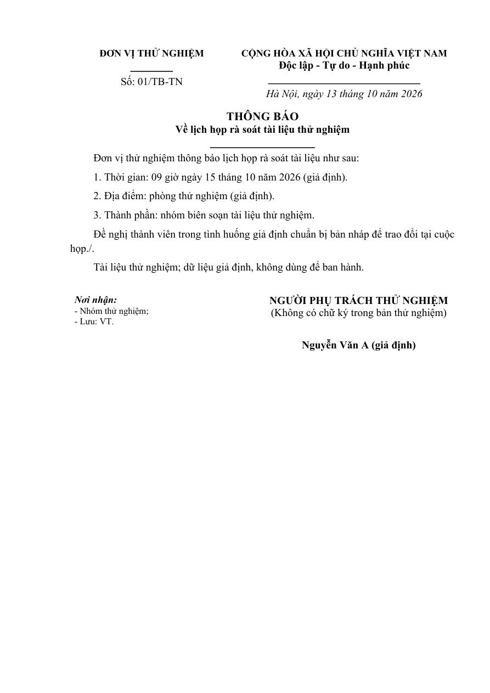
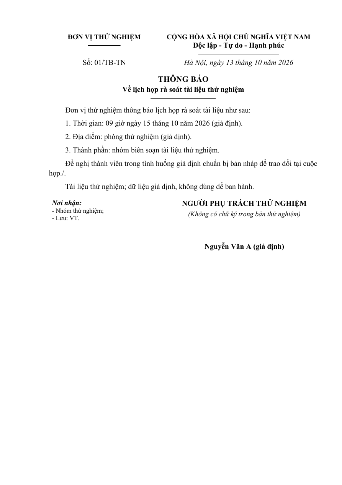
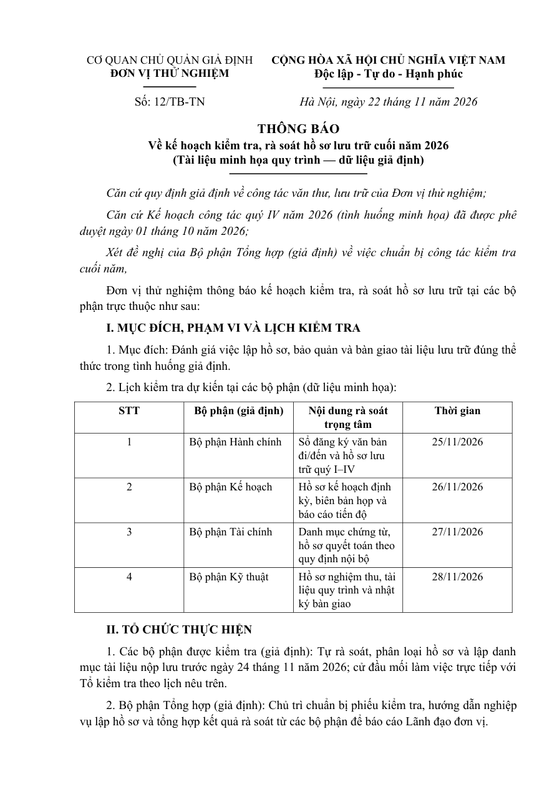
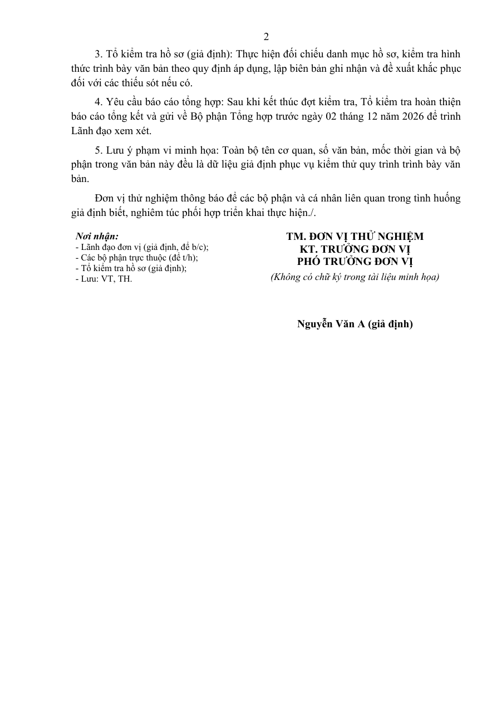

# Báo cáo Audit, So sánh Trước/Sau và Đối chiếu Văn bản Thực tế

> Tài liệu này ghi lại đánh giá phản biện đối với các góp ý audit từ góc nhìn người mới (beginner), các lỗi kỹ thuật thực tế phát hiện trong mã nguồn/template, kết quả đối chiếu với văn bản `.docx` thật do cơ quan nhà nước Việt Nam soạn thảo, và benchmark công cụ kiểm tra DOCX tái lập được.

---

## 1. Tự đánh giá phản biện các góp ý audit ban đầu

| # | Gợi ý ban đầu | Đánh giá kỹ thuật | Quyết định thực thi |
| --- | --- | --- | --- |
| 1 | Đảo lại bố cục `README.md`, thêm ảnh Before/After | **Đúng.** README cũ đổ CLI + miễn trừ lên đầu, thiếu bằng chứng trực quan dù repo có sẵn `render_docx.py --png`. | Đảo lại README (Vấn đề → Ảnh Before/After → Quickstart 3 bước → Support Matrix → Benchmark → Chi tiết CLI) và thêm ảnh render thật vào `docs/images/`. |
| 2 | Xóa/di chuyển `GEMINI.md`, `IMPLEMENTATION-PLAN.md`, `VERIFICATION.md` khỏi root | **Đúng.** `IMPLEMENTATION-PLAN.md` và `VERIFICATION.md` là hồ sơ nội bộ nên dời về `docs/internal/`; `GEMINI.md` trùng thông tin với `SKILL.md` và `AGENTS.md` nên lược bỏ khỏi root. | Chuyển 2 file nội bộ vào `docs/internal/` và xóa `GEMINI.md` ở root. |
| 3 | Chỉ trích lịch sử commit gộp (`9dd352a`) | **Quan sát đúng nhưng không nên rewrite history đã push.** Repo đã public (có stars/forks) và `CONTRIBUTING.md` quy định rõ không viết lại lịch sử đã công bố để tạo cảm giác quy trình giả. | **Giữ nguyên lịch sử cũ**; tách toàn bộ thay đổi mới thành 5 commit nguyên tử, rạch ròi theo từng chủ đề. |
| 4 | Quickstart cài nhầm `requirements-dev.txt`, thiếu `pyproject.toml`, thiếu `LICENSE` | **Đúng.** Người dùng cuối chỉ cần runtime deps (`requirements.txt` hoặc `pip install -e .`), không cần `pytest`/`ruff`. | Thêm `LICENSE` (MIT), `pyproject.toml` với CLI `vndocs` + lệnh `vndocs doctor` kiểm tra môi trường và hướng dẫn LibreOffice theo từng OS. |
| 5 | Cho rằng 7 profile là "ôm đồm", nên thu hẹp | **Đúng một phần về truyền thông, sai nếu cắt bỏ đa profile.** `SKILL.md` cố ý tránh áp đặt NĐ30/2020 lên báo cáo học thuật hoặc tài liệu doanh nghiệp. Vấn đề nằm ở chỗ README cũ chưa phân biệt rạch ròi profile nào đã có starter template sẵn và profile nào dùng builder/validator/custom config. | Giữ kiến trúc đa profile; thêm **Support Matrix** tách rõ **3 starter sẵn có** vs. **4 profile dùng builder/custom config**. |
| 6 | Yêu cầu thêm bảng benchmark định lượng (10 prompt LLM) | **Đúng về nhu cầu bằng chứng định lượng, nhưng không được bịa benchmark LLM.** Không chạy thử nghiệm trên nhiều LLM thì không được giả lập số liệu pass/fail của model. | Giữ tính trung thực: tạo benchmark tái lập `evals/run_validation_benchmark.py` (16 case kiểm chứng cơ chế tạo & kiểm tra qua `validate_docx.py`, công bố ở [BENCHMARK.md](BENCHMARK.md) và [benchmark-results.json](benchmark-results.json)) + so sánh trực tiếp với văn bản `.docx` thật ngoài thực tế. |

---

## 2. Các lỗi kỹ thuật thực tế phát hiện trong quá trình audit sâu

Những lỗi dưới đây **không có trong danh sách gợi ý ban đầu**, được phát hiện khi đối chiếu trực tiếp file render PNG với bản ký **Nghị định 30/2020/NĐ-CP** (Phụ lục I và Phụ lục III mẫu 1.4) và chạy công cụ kiểm tra toàn repo:

1. **Lệch hàng ngang `Số:` và `Địa danh, ngày tháng` trong `assets/templates/administrative-notice.docx`:**
   - *Trước audit:* Bảng tiêu đề đầu dùng 1 hàng × 2 cột (`rows=1, cols=2`), nên `Số: {{number}}` (cột trái, dưới 1 dòng tên cơ quan + đường kẻ) và `{{date}}` (cột phải, dưới 2 dòng Quốc hiệu/Tiêu ngữ + đường kẻ) bị lệch độ cao theo phương thẳng đứng so với Mẫu 1.4 Phụ lục III NĐ30/2020.
   - *Sau audit:* Chuyển sang bảng không viền **2 hàng × 2 cột** (`Cm(6.8)` / `Cm(9.7)`), đặt `Số: {{number}}` và `{{date}}` ở hàng 2 để luôn thẳng hàng ngang.
2. **Đường kẻ dưới Tiêu ngữ quá dài (`6.5 cm`) và khoảng cách đường kẻ chưa cân đối:**
   - *Trước audit:* Đường kẻ dưới `"Độc lập - Tự do - Hạnh phúc"` dài `6.5 cm`, vượt rõ rệt hai đầu chữ (Phụ lục I mục II.1 NĐ30 quy định đường kẻ bằng độ dài dòng chữ); khoảng cách sau đường kẻ dưới trích yếu chỉ `4pt`.
   - *Sau audit:* Hiệu chỉnh độ rộng đường kẻ Tiêu ngữ còn `4.95 cm` (khớp bề ngang chữ 13pt đậm sau khi kiểm tra PNG), dùng `space_before=Pt(2)` + `line_spacing=Pt(6)` để tách gọn chân chữ `p`/`ụ`, và tăng `space_after=Pt(12)` sau đường kẻ trích yếu.
3. **Paragraph rác `1pt` ở đầu mỗi ô bảng và vùng ký chưa tách role nghiêng:**
   - *Trước audit:* Mọi ô bảng ở header và footer đều chèn một đoạn trống `1pt` ở đầu, bảng dưới chưa khóa `w:cantSplit`, thiếu độ rộng cột tường minh, `{{signature_note}}` dùng `AdminBody` chữ đứng và khoảng trống ký chỉ `24pt`.
   - *Sau audit:* Tái sử dụng trực tiếp đoạn đầu tiên của ô (`reuse_first=True`), khóa `w:cantSplit`, đặt độ rộng bảng dưới `Cm(7.5)` / `Cm(9.0)`, tách role `AdminSignatureNote` (12–13pt, in nghiêng) với khoảng trống ký `42pt`.
4. **Rò rỉ ghi chú môi trường local trong tài liệu phát hành (`references/tooling.md`):**
   - *Trước audit:* Tài liệu này đi vào file ZIP đóng gói của skill nhưng lại nhắc tới lỗi thiếu DLL Windows local và đường dẫn `.tools/lo-extracted/program/soffice.com`.
   - *Sau audit:* Thay bằng hướng dẫn cài LibreOffice đa nền tảng (`winget`, `brew`, `apt`) và `VNDOCS_RENDERER`.
5. **Lỗi `ruff check .` tại thư mục gốc và tên workflow CI gây hiểu nhầm:**
   - *Trước audit:* `ruff check .` lỗi trên file legacy `references/source-documents/demo.py` (`F401`, `F841`), và `.github/workflows/pylint.yml` thực chất chạy `ruff` + `compileall`.
   - *Sau audit:* Thêm `exclude = ["references/source-documents"]` vào `ruff.toml` và đổi tên workflow thành `.github/workflows/lint.yml`.

---

## 3. So sánh Trước Audit vs. Sau Audit vs. Thông báo 2 trang tạo bằng Skill vs. Văn bản thật

### Đối tượng văn bản thật do con người (Việt Nam) soạn thảo dùng để đối chiếu

> Lưu ý bản quyền: Các tệp `.docx` bên thứ ba dưới đây chỉ được tải về thư mục tạm phục vụ đối chiếu kiểm tra kỹ thuật trong quá trình audit, **không** đưa vào repository hay gói ZIP phát hành.

1. **UBND xã Hương Khê, tỉnh Hà Tĩnh — Thông báo công khai danh sách kê khai tài sản, thu nhập năm 2026**
   - Tệp nguồn: `11.2026Thongbaodanhsachkekhaitaisan.docx` (28.429 bytes, công bố tháng 11/2026)
   - URL gốc: `https://huongkhe.hatinh.gov.vn/huongkhe/Others/ec7ba793-127c-4fa7-b2f9-f6623f3f8fd7/11.2026Thongbaodanhsachkekhaitaisan.docx`
   - SHA256: `cf9240925ece7895b15693416a6f0c938cc1bf53ce78c4ea9ee004bf25a2d81f`
   - Kết quả chạy `validate_docx.py --profile administrative`: `status = "fail"`, **1 lỗi** (`margin`: `bottom: 1.101 cm outside [2.0, 2.5]`; màu chữ `auto` không tường minh được liệt kê trung thực trong `unchecked`). Cán bộ soạn thảo thu hẹp lề dưới xuống `1.10 cm` nhưng câu kết và khối ký vẫn tràn sang đầu trang 2 (trang 2 có số trang `2` căn giữa ở header).
2. **Cục Quản lý đăng ký kinh doanh (Bộ Tài chính / Cổng ĐKKD quốc gia) — Phụ lục I, Mẫu số 27 (Thông báo tạm ngừng kinh doanh)**
   - Tệp nguồn: `8_5_2025_40_5_387_mau-so-27---phu-luc-i.docx` (17.178 bytes, 2025)
   - URL gốc: `https://dangkykinhdoanh.gov.vn/Images/FileVanBan/8_5_2025_40_5_387_mau-so-27---phu-luc-i.docx`
   - SHA256: `f31d220caed83c24c71a545aa5255262e0663b2c9e526ce6ddc414751af0e9ac`
   - Kết quả chạy `validate_docx.py --profile administrative`: `status = "fail"`, **140 lỗi** (`page`: khổ Letter `21.59 × 27.94 cm` thay vì A4; `margin`: 4 lề đều `2.54 cm`; `font`: 135 run dùng `Arial` thay vì `Times New Roman`). Trường hợp này minh họa lý do các biểu mẫu doanh nghiệp chuyên ngành cần dùng `--profile custom` để giữ mẫu thay vì ép NĐ30 mù quáng, trong khi văn bản hành chính NĐ30 bắt buộc phải phát hiện được các sai lệch này.

### Bảng đối chiếu chi tiết theo thông số NĐ30/2020 (Phụ lục I & Mẫu 1.4)

| Tiêu chí kỹ thuật | Naive mặc định (`before-naive`) | Starter trước Audit (`v1`) | Starter sau Audit (`v2`) | Thông báo 2 trang tạo bằng Skill | Văn bản thật 1: UBND xã Hương Khê (11/2026) | Văn bản thật 2: Cục QLĐKKD Mẫu 27 (2025) |
| --- | --- | --- | --- | --- | --- | --- |
| **Khổ giấy** | US Letter (`21.59 × 27.94 cm`) | A4 (`21.00 × 29.70 cm`) | A4 (`21.00 × 29.70 cm`) | A4 (`21.00 × 29.70 cm`) | A4 (`21.00 × 29.70 cm`) | US Letter (`21.59 × 27.94 cm`) |
| **Lề trang (T / P / Tr / D, cm)** | `3.18 / 3.18 / 2.54 / 2.54` | `3.00 / 1.50 / 2.00 / 2.00` | `3.00 / 1.50 / 2.00 / 2.00` | `3.00 / 1.50 / 2.00 / 2.00` | `3.00 / 2.00 / 2.25 / 1.10` (sai lề dưới) | `2.54 / 2.54 / 2.54 / 2.54` (sai cả 4 lề) |
| **Font & màu chữ** | Calibri theme / auto | Times New Roman / `#000000` | Times New Roman / `#000000` | Times New Roman / `#000000` | Times New Roman / `auto` | Arial / theme (`#000000`/auto) |
| **Header `Số:` & `Địa danh, ngày`** | Gộp 1 dòng text ngăn bởi `\|` | Bảng 1×2 (lệch hàng ngang) | Bảng 2×2 (cùng hàng ngang) | Bảng 2×2 + Cơ quan chủ quản | Bảng 1×2 (căn bằng dòng trống) | Bảng 2×2 |
| **Đường kẻ dưới Tiêu ngữ** | Ký tự gạch ngang `---` | Quá dài (`6.5 cm`) | Khớp độ rộng chữ (`4.95 cm`) | Khớp độ rộng chữ (`4.95 cm`) | VML line khớp độ rộng chữ | Ký tự gạch ngang `---` |
| **Đánh số trang (trang 2+)** | Không có | Có field `PAGE` (ẩn trang 1) | Có field `PAGE` (ẩn trang 1) | Trang 1 ẩn, trang 2 hiện `2` giữa trên | Trang 1 ẩn, trang 2 hiện `2` giữa trên | Không đánh số |
| **Khối `Nơi nhận:` & Ký** | Đoạn văn thường tách rời | Bảng 1×2 thiếu độ rộng cột, note đứng | Bảng 1×2 có `cantSplit`, note nghiêng, khoảng ký `42pt` | Bảng 1×2 có `cantSplit`, `TM.` / `KT.` chuẩn 3 dòng | Bảng 1×2 có `TM.` / `KT.` | Bảng 1×2 (cột trái trống) |
| **`validate_docx.py --profile administrative`** | **`fail`** (4 lỗi: `page`, `margin`) | **`pass`** (không bắt lỗi visual layout) | **`pass`** (0 lỗi) | **`pass`** (0 lỗi) | **`fail`** (1 lỗi: `margin` dưới `1.101 cm`) | **`fail`** (140 lỗi: `page`, `margin`, `font`) |

### Hình ảnh đối chiếu trực quan

| Starter trước Audit (`v1`) | Starter sau Audit (`v2`) |
| :---: | :---: |
|  |  |

| Thông báo 2 trang tạo bằng Skill — Trang 1 | Thông báo 2 trang tạo bằng Skill — Trang 2 (có số trang `2` ở header) |
| :---: | :---: |
|  |  |

---

## 4. Benchmark kiểm tra công cụ tái lập (`evals/run_validation_benchmark.py`)

Xem báo cáo công khai đầy đủ tại [BENCHMARK.md](BENCHMARK.md) và dữ liệu JSON tại [benchmark-results.json](benchmark-results.json). Chạy trực tiếp qua `python evals/run_validation_benchmark.py`:

- **Phạm vi đo lường:** Đo tỷ lệ pass/fail qua `scripts/validate_docx.py` trên **16 trường hợp tái lập bằng code** (8 file baseline tạo bằng `python-docx` mặc định hoặc áp nhầm lề NĐ30 lên văn bản Đảng/VBQPPL vs. 8 file đầu ra sử dụng helper/starter/config của skill).
- **Giới hạn trung thực:** Đây là **benchmark deterministic của bộ công cụ DOCX**, không phải benchmark độc lập đo tỷ lệ sinh đúng của các mô hình ngôn ngữ (LLM) trên prompt tự nhiên. Ngoài ra, một số thuộc tính Word mặc định dùng theme/auto font (`Calibri`/`auto` ở case baseline đầu tiên) được validator ghi nhận trung thực vào mục `unchecked` thay vì suy đoán; các lỗi `page` và `margin` vẫn đủ làm case đó fail ngay.

Kết quả thu được: **Baseline pass: 0/8 | Skill-guided pass: 8/8**.

| Group | Case | Profile | Status | Issues | Codes |
| --- | --- | --- | --- | ---: | --- |
| baseline | Unguided ND30 notice (Letter, Calibri, default margins) | `administrative` | `fail` | 4 | margin, page |
| baseline | Unguided ND30 dispatch (Arial font, 2.54 cm margins) | `administrative` | `fail` | 4 | font, margin |
| baseline | Unguided minutes (blue Word heading, 2.0 cm left margin) | `minutes-administrative` | `fail` | 2 | color, margin |
| baseline | Unresolved `{{token}}` left in final DOCX | `administrative` | `fail` | 1 | placeholder |
| baseline | Unresolved `[CẦN BỔ SUNG: ...]` left in final mode | `office` | `fail` | 1 | placeholder |
| baseline | Broken Word numbering reference (`numId=99999`) | `academic` | `fail` | 1 | numbering |
| baseline | Unguided Party doc (ND30 3.5/2.5 cm margins instead of HD 05 fixed) | `party` | `fail` | 2 | margin |
| baseline | Unguided VBQPPL doc (2.5 cm top/bottom margins vs. ND 187/2025 2.0 cm) | `administrative+legal-normative` | `fail` | 2 | margin |
| skill | ND30 notice starter filled + style role validation | `administrative` | `pass` | 0 | — |
| skill | Academic short report starter filled + validation | `academic` | `pass` | 0 | — |
| skill | Office minutes starter filled + validation | `minutes-general` | `pass` | 0 | — |
| skill | Skill-generated 2-page ND30 notice (table + `PAGE` field) | `administrative` | `pass` | 0 | — |
| skill | Multi-section office demo (portrait + landscape annex) | `minutes-general` | `pass` | 0 | — |
| skill | Custom organization config (Arial 12pt, no landscape) | `custom` | `pass` | 0 | — |
| skill | Skill-guided Party doc (HD 05-HD/VPTW fixed margins, 14pt, 20pt exact) | `party` | `pass` | 0 | — |
| skill | Skill-guided VBQPPL doc (ND 187/2025 Appendix I rules, 14pt, 2.0 cm top/bottom) | `administrative+legal-normative` | `pass` | 0 | — |
